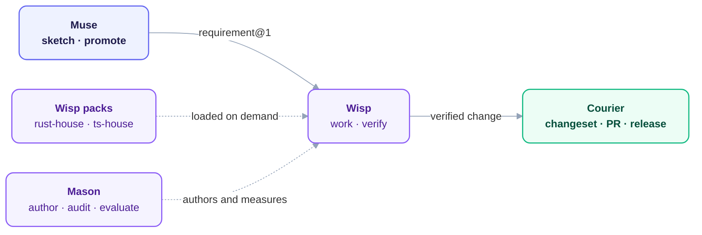
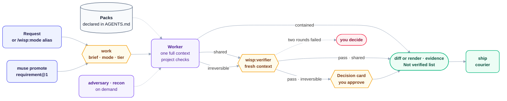
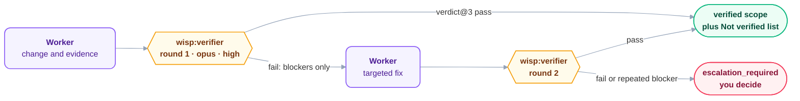
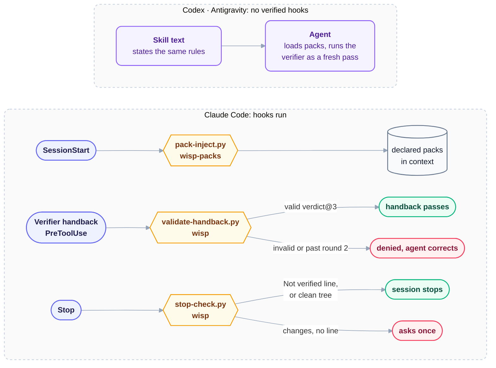
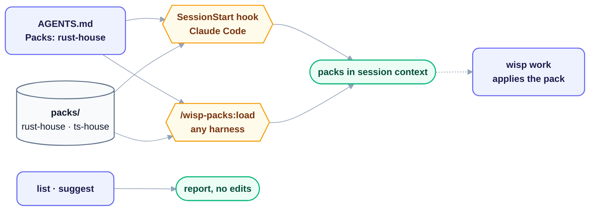
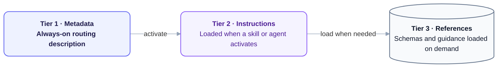
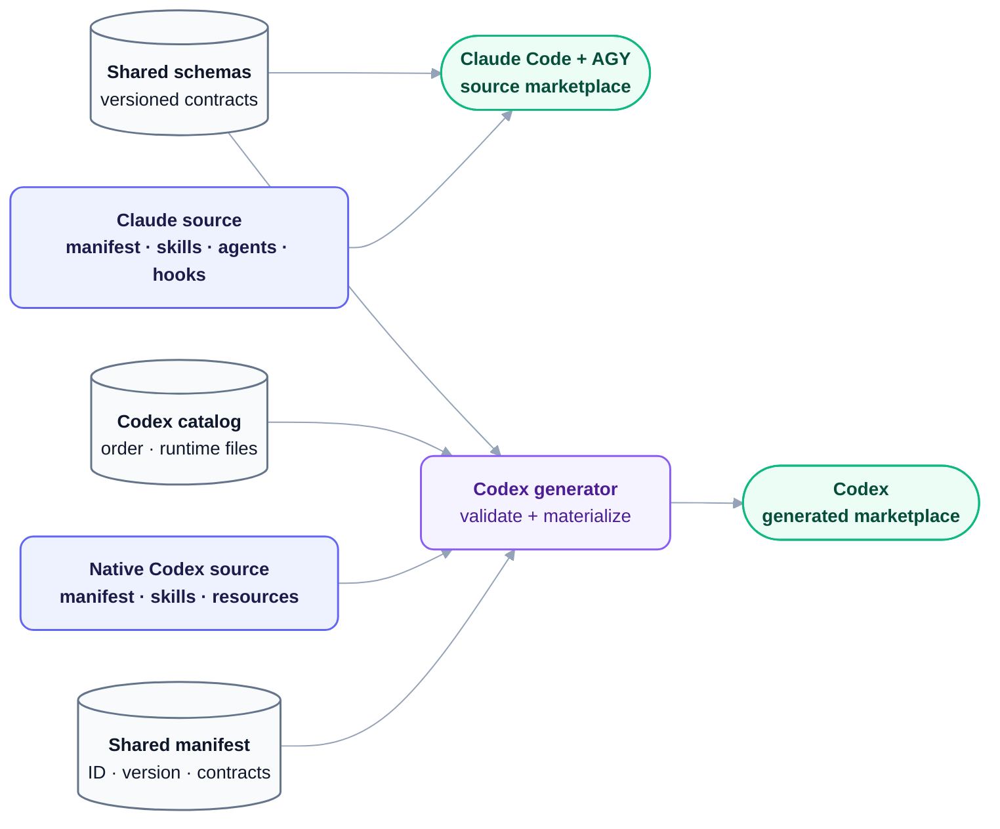
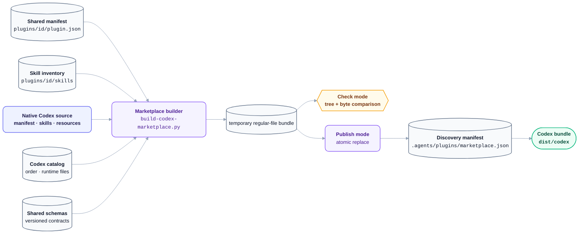

# Architecture

How the plugins are built, what each part enforces, and how they reach Claude Code, Antigravity (AGY) and Codex. Start with the table, then read the section for your task.

| You want to | Read |
| :--- | :--- |
| Pick the plugins to install | [1](#1-the-v5-plugin-set) |
| Know what `wisp` does with a request, and when review runs | [2](#2-how-a-request-flows-through-wisp) |
| Add or tier an agent | [3](#3-agents-and-model-tiers), [7](#7-agent-authoring-principles) |
| Understand the verifier, its rounds and the evidence it needs | [4](#4-verification-protocol) |
| Know which rules are enforced by a hook, and where hooks do not run | [5](#5-hooks-and-where-they-run) |
| Adopt a pack in a repository | [6](#6-packs) |
| Change a schema, a reference or a skill | [4](#4-verification-protocol), [7](#7-agent-authoring-principles) |
| Change what Codex gets, or understand the Codex bundle | [8](#8-cross-harness-distribution), [9](#9-codex-marketplace-build-system) |
| Run checks, release or measure a workflow | [11](#11-validation-and-release-model) |
| Find the decision behind a rule | [13](#13-decision-records) |

---

## 1. The v5 Plugin Set

Install `wisp` for the work itself. Add the others for the job they do. Every plugin installs on its own; a plugin is replaceable by one that honours the same schema contract (a Jira plugin replacing the requirement source only has to emit `requirement@1`).

| Plugin | Role | Entry points | Agents |
| :--- | :--- | :--- | :--- |
| `wisp` | The core: sizes a change by reversibility and blast radius, does the work in one full context, runs a fresh-context independent check where a confident mistake is costly | `/wisp:work` and six mode aliases: `explore`, `spike`, `fix`, `build`, `check`, `ship` | `verifier`, `adversary`, `recon` |
| `wisp-packs` | House packs `wisp` applies when work needs them (`rust-house`, `ts-house`) | `/wisp-packs:load`, `list`, `suggest`; a `Packs:` line in `AGENTS.md` | none |
| `courier` | Shipping: commit message, pull request text, changeset, review-feedback triage, posting a review, release | `changeset`, `commit`, `pr`, `receive-feedback`, `post-review`, `release` | `changeset-analyzer`, `commit-analyzer`, `pr-narrator` |
| `muse` | Options before a decision: `sketch` builds and renders structurally different options; `promote` carries the chosen one into a `requirement@1` | `sketch`, `promote` | `explorer` |
| `mason` | Plugin authoring: scaffold and audit plugins, design schemas, scaffold an agent, evaluate a workflow | `scaffold-plugin`, `audit-plugin`, `design-schema`, `scaffold-subagent`, `evaluate` | see [section 3](#3-agents-and-model-tiers) |

How `courier` and `muse` behave:

- **Changesets** follow the repository's own rules and file format (for example `.changeset/*.md`) and are saved there with the package and bump. An entry is layered: a bold lead-in naming the change as the user sees it, its value, then short bullets; `**Breaking:**` and `**Action:**` paragraphs are separate so release tools list them.
- **Pull requests:** `courier:pr` hands the title and body to the branch's Entire trail, and Entire opens the PR. It opens one itself only where the repository says agents do, and always after you confirm.
- **Release:** `courier:release` aggregates `changeset@3` entries into a `release-artifact@3` in the primary agent; tagging and publishing stay with `just release` (section 11).
- **Sketch:** `muse:sketch` builds three structurally different options per round (five at most), with up to three `explorer` agents building in parallel, renders them before describing them, and keeps an append-only decision log in an `option-set@1`.

Typed handoffs that remain: `option-set@1` and `requirement@1` (`muse`), `spike-report@1` (`wisp`), `changeset@3` and `release-artifact@3` (`courier`), `verdict@3`, `candidate-assessment@1` and `workspace-manifest@1` (`wisp` agents), `evaluation-run@1` and `harness-evaluation@2` (`mason`). Schemas of retired plugins stay on disk, immutable.



---

## 2. How a Request Flows Through Wisp

You state the request or start a mode. `wisp` answers with a brief and a tier before editing anything, asks you only for decisions that change scope or cannot be undone, and returns evidence.

| Step | What happens |
| :--- | :--- |
| Brief | The reply opens with `Mode: <mode>. Tier: <tier>.` and the brief: outcome, constraints, evidence bar. No evidence bar, no work: it asks once, or explores or spikes first |
| Tier | Reversibility and blast radius set the tier; when two fit, the higher wins |
| Work | The primary agent researches, implements and tests in one context. A forked read-only search is a context split, not a role |
| Review | The tier alone sets depth (table below) |
| Out | The diff or render, each command with its observed result, a `Not verified:` list, and the pull request or changelog text |

| Tier | Signals | Review |
| :--- | :--- | :--- |
| contained | Reverts cleanly, nothing depends on it, a project check exercises it | The project's checks and a failing-then-passing test; no verifier |
| shared | Other code, users or sessions depend on it; a public interface, schema, shared config or CI; a spec or plan that makes claims about code | Checks, then `wisp:verifier`: one round and one targeted retry |
| irreversible | Hard to undo or crosses the repository boundary: migration, publish, tag, release, push to a shared branch, spend, another repository | The verifier, then a decision card before the action |

| Mode | Use when | Hands off to |
| :--- | :--- | :--- |
| `explore` | You want options before deciding | `muse:sketch`, then `muse:promote` |
| `spike` | You want to know whether something works here; a throwaway experiment returning `spike-report@1` | `muse:promote` when it works |
| `fix` | Something is broken or a review left findings | The verifier from shared tier |
| `build` | The outcome is known | The verifier from shared tier |
| `check` | Confirm work against a brief, or hunt defects | The verifier, and the adversary per suspected defect |
| `ship` | The work is ready to go out | `courier`; you confirm before any push, post or publish |

Rules that hold across modes:

- **Decision cards:** short, with a recommendation and a default. Changing a guardrail or ADR, loosening a check, adding an agent or plugin, publishing a schema version, tagging or releasing, pushing to a shared branch or touching another repository always gets a card.
- **No mandatory stages:** a spec or plan is written only for a shared contract or when you ask for one (`shared/references/work/specs-and-plans.md`).
- **Exploration is non-binding:** a sketch or spike has no gate and enters real work only through `muse:promote` (ADR 011).



---

## 3. Agents and Model Tiers

Add an agent only where a separate context or a different risk tier pays for itself (ADR 018). Pick the lowest tier that produces correct output; Opus is for decisions that produce a binding verdict.

| Tier | Agents | Used for |
| :--- | :--- | :--- |
| `haiku / low` | `wisp:recon`, `courier:commit-analyzer`, `mason:evaluation-runner` | Deterministic enumeration and mechanical work |
| `sonnet / medium` | `courier:changeset-analyzer`, `courier:pr-narrator`, `muse:explorer`, `mason:auditor`, `mason:scaffolder`, `mason:schema-designer` | Analysis and drafting |
| `opus / high` | `wisp:verifier`, `wisp:adversary`, `mason:evaluation-adjudicator` | Verdicts and refutation that decide a finding |

The `wisp` agents:

| Agent | Does | Returns |
| :--- | :--- | :--- |
| `verifier` | Fresh-context check of shared or irreversible work, or of a spec or plan that makes claims about code. Gets the brief, the change and the evidence, never the worker's reasoning; runs code, a build or a render itself | `verdict@3` |
| `adversary` | Settles one disputed finding or claim: confirms only with a concrete failing scenario, dismisses only with the guard that blocks it | `candidate-assessment@1` |
| `recon` | Read-only inventory of an unfamiliar workspace: languages, entry points, the project's check commands, workspace state | `workspace-manifest@1` |

`model` and `effort` are routing hints in each Claude/AGY agent's frontmatter. Claude Code honours them; AGY applies its own routing; Codex uses host-selected models and role cards, so tier intent carries over without copying model configuration.

---

## 4. Verification Protocol

Use this section to know what a pass from the verifier means and what stops a loop.

- **Input:** the brief, the change and the evidence list. A brief with no evidence bar fails.
- **Output:** `verdict@3`, default-fail: the complete blocker set in round one, then only known blockers or regressions on a retry (ADR 013). Anything else becomes a non-blocking coverage gap.
- **Retry:** the worker receives only the blockers array and makes a targeted fix.
- **Rounds:** two. The caller sets `retry_count` to the number of earlier rounds (0 in round one). A fail at `retry_count` 1 or later, or a repeated blocker, adds an `escalation_required` blocker and the persistent blockers come to you (ADR 015).



### Schema contract

Schemas in `shared/schemas/` are the inter-agent API surface.

- **Format:** JSON Schema draft-2020-12, `additionalProperties: false`; unknown fields are rejected at validation time.
- **Scratchpad:** every new schema includes `reasoning: string`, a private field never forwarded downstream (`candidate@1` and `implementation-context@1` predate the rule).
- **Immutable versions:** `requirement@1.json` never changes; a breaking change produces `requirement@2.json`.
- **Validation timing:** build checks validate wiring and that schemas parse; fixture artifacts are validated in tests; agents are told to conform. The one runtime validator is the handback hook (section 5), which checks `verdict@3` only.

### Verification evidence

Verification is claim-driven, not tool-driven: choose available project-native checks from the language, repository capabilities, changed behavior and failure cost.

| Claim | Evidence that can support it |
| :--- | :--- |
| A boundary preserves behavior | An observation at the nearest executable compile, serialization, process, network, storage, render or environment boundary |
| Generated inputs explore the risk | A named generator plus a behavioral oracle that can reject bad output |
| A defect family is exhausted | Candidate sites derived independently from domain responsibility, state transitions and architecture, with an outcome for each site |
| A fix is structurally complete | A shared root cause and an explicit decision: scoped repair, consolidation or structural remediation |
| Mutable or asynchronous behavior passes | Fresh state and terminal results for every relevant started check |

Unavailable or disproportionate checks become explicit coverage gaps; invoking a tool without a relevant oracle proves nothing. Rust, TypeScript/JavaScript, Python and Go references suggest compatible tools without making one command mandatory.

---

## 5. Hooks and Where They Run

Rules that must hold are hooks, not prompts. Hooks run only in Claude Code; Codex has none of them and Antigravity's support is unverified, so each `wisp` skill states the same rule in its text. All three hooks fail open: a broken hook never stalls a session.

| Hook | Event | Plugin | Enforces | Switch |
| :--- | :--- | :--- | :--- | :--- |
| `shared/hooks/validate-handback.py` | `PreToolUse` on `SubagentHandback` | `wisp` | A `wisp:verifier` handback conforms to `verdict@3` and does not pass or fail past the two-round limit without escalating (ADR 012, 015). It denies an invalid handback up to three times per agent, then lets it through for the orchestrator to escalate. Runs only in auto mode, for locally run subagents | `WISP_HANDBACK_TRACE=<file>` appends one JSON line per inspected event |
| `shared/hooks/stop-check.py` | `Stop` | `wisp` | With uncommitted changes, the final message carries a `Not verified:` line. It asks once; the next stop passes (ADR 018) | `WISP_STOP_CHECK=off` disables it |
| `shared/hooks/pack-inject.py` | `SessionStart` | `wisp-packs` | Injects each pack a repository declares in a `Packs:` line of `AGENTS.md`, once, however many files name it | none |

A plugin registers hooks in `plugins/<id>/hooks/hooks.json`. A new agent that issues a binding `verdict@3` needs a `ROUTES` entry in `validate-handback.py` and a new ADR (ADR 018). Repository-local hooks (the commit-time integrity guard) are separate: [`docs/repository-hooks.md`](./docs/repository-hooks.md).



---

## 6. Packs

A pack is a short markdown file on how the owner builds in one area: when it applies, what to do differently from a model's default, the checks that prove it, and a file to imitate. Packs ship in `wisp-packs` (`plugins/wisp-packs/packs/`): `rust-house` for Rust workspaces and `ts-house` for TypeScript packages built with pnpm.

Adopt a pack by adding one line to the `AGENTS.md` where it applies:

```markdown
Packs: rust-house, ts-house
```

| Command | Does | Edits files |
| :--- | :--- | :--- |
| `/wisp-packs:load <name>` | Reads the named packs and applies them for the rest of the session, on any harness | No |
| `/wisp-packs:list` | Lists available packs and the `Packs:` lines the repository declares | No |
| `/wisp-packs:suggest` | Recommends packs for the repository and where to declare them | No |

How the hook reads declarations (Claude Code only):

- **Where:** `AGENTS.md` at the working directory, in the directories above it up to the repository root, and in directories up to four levels below it (monorepo packages).
- **Once:** a pack named in several files is injected once. An unknown name, or a `Packs:` line inside a fenced code block, is ignored.
- **Bounds:** at most 64 files, 256 KB per file and 60,000 characters of context.
- **Codex and Antigravity:** nothing is injected; `AGENTS.md` is already in context, so the agent loads the pack with `load` when it starts work.

Pack rules: a pack never adds a command the repository does not declare; the repository's `AGENTS.md` and your instructions win over a pack; a pack may tighten a check unasked but loosening one needs you. Packs are prompt content, so installing one is a trust decision.



---

## 7. Agent Authoring Principles

Use this section before writing or changing a plugin, skill, agent or reference. Full guide: `shared/agent-best-practices.md`; hard rules: `shared/constitution.md`.

### Plugin layout

```
plugins/<id>/
├── plugin.json              ← Manifest: id, version, description, skills, agents list
├── README.md                ← Plugin documentation
├── CHANGELOG.md             ← Version history
├── hooks/hooks.json         ← Only when the plugin ships a Claude Code hook
├── skills/<id>/SKILL.md     ← Skill prompt (what the user invokes)
└── agents/*.md              ← Agent prompts; few
```

- `plugin.json` fields: `id`, `version` (semver), `description`, `skills` (path to skills dir), `agents` (list of agent file paths).
- A plugin defaults to one skill directory named after its id. It may split into `skills/<skill-name>/SKILL.md` per skill when its scope covers several independent intents (`courier`, `mason`, `muse`). `wisp` keeps one `work` skill with one-line mode aliases. The routing key is the directory name, not the frontmatter `name:`.

### Context and risk split

- One worker researches, implements and tests in one context. A second agent exists only for an independent check (`wisp:verifier`), one disputed finding (`wisp:adversary`), a cheap read-only inventory (`wisp:recon`), or a bulk sweep or hidden oracle kept out of the worker's context.
- `wisp` adds no role agent, per-stage gate or mandatory spec or plan stage without a new ADR (ADR 018). Handoff documents lose context; independence rests on a fresh context and a checkable brief, not on more roles.
- Tiers are in [section 3](#3-agents-and-model-tiers).

### Agent structure

| Part | Purpose |
| :--- | :--- |
| **Constitution** | Ecosystem-wide invariants, byte-identical across every agent, the shared cache prefix. Copied verbatim, never authored per agent |
| **Goal** | What the agent must produce and why. Intent, not steps |
| **Judgment** | How to tell the goal was achieved from output that looks like it. Names the key failure mode |
| **Output** | Output shape, referencing a schema from `shared/schemas/` when it flows to another agent |

No `<role>` or `<backstory>` body section (ADR 017); the frontmatter `role:` is a display label only. Codex skills and role cards use native structures; cross-harness parity applies to route names, artifacts, evidence and acceptance intent.

### Rules that apply to every prompt

- **Progressive context loading:** each agent loads only the focused references its task needs, named in one `<load_first>` block. The first directory names the concern; a language filename narrows language-specific evidence. Never load all references into all agents.
- **EARS for edges only:** `WHEN`, `IF`, `WHILE`, `WHERE` belong in output contracts and never-do rules, not in implementation steps or search strategies.
- **Schema-driven handoffs:** both sides of a handoff reference the same file in `shared/schemas/`. The schema is the contract; the prompt describes intent.
- **Radical candor:** state material concerns, evidence, consequence and confidence directly; do not soften blockers or manufacture praise.
- **Reference guidance:** a heuristic is a candidate signal until live evidence confirms a reachable outcome; applicability, refutation and disposition keep preferences from becoming universal defects.
- **Abstract tool language:** "use your file reading tool", never a tool-specific call, so prompts stay portable.



Agents pull references with their file reading tool; the host never pre-loads them. The one exception is a pack a repository declares in `AGENTS.md`, which the `wisp-packs` hook injects at session start (section 6).

---

## 8. Cross-Harness Distribution

Use this section to know what differs between hosts. One contract (the versioned JSON artifact) and harness-specific packages: Claude Code and AGY consume the authored `plugins/` tree directly; Codex consumes a generated, materialized marketplace. No custom server framework is required.

| Concern | Claude Code | Antigravity (AGY) | Codex |
| :--- | :--- | :--- | :--- |
| Source | `plugins/<id>/` | The same tree | `harnesses/codex/plugins/<id>/`, packaged to `dist/codex` |
| Plugin metadata | `plugins/<id>/plugin.json` | The same | Native `.codex-plugin/plugin.json`, version- and author-checked against the shared manifest |
| Workflow | Skills and named agents | Skills and named agents; routing is the host's | Separately authored skills; optional agent teams from packaged role cards; complete single-agent fallback |
| Verifier | `wisp:verifier` subagent | Same, support unverified | A fresh subagent from a role card, or a separate pass when subagents are unavailable |
| Hooks (handback, Stop, pack inject) | Run | Not verified | None: skills state the `Not verified:` and round rules, and the agent loads packs from the `AGENTS.md` line |
| Marketplace | Root marketplace files | Git URL or `agy-plugin` | `.agents/plugins/marketplace.json`, pointing at `dist/codex/` |
| Runtime paths | Relative; source symlinks may share context | Same | Regular files only; no symlinks in output |

`plugins/<id>/plugin.json` stays authoritative for shared ID, version, author and produced and consumed artifacts. `harnesses/codex/plugins/<id>/` owns the Codex manifest, skills, category, capability, resource and team-use choices. `harnesses/codex/catalog.json` owns marketplace order and runtime-file materialization. `tools/build-codex-marketplace.py` packages `dist/codex` and writes the root discovery manifest; generated files are reviewed and released with their sources, never edited by hand.



The schema is the cross-harness contract. Named agents, model routing, prompt wording, tool availability and delegation strategy are harness-specific.

- A source change is shared only when it affects plugin identity or a versioned artifact contract.
- A workflow change is compatible only when both harnesses preserve the intended schema, evidence and acceptance criteria; transcript or prose identity is not required.
- Codex may use an agent team for independent work, but a missing team capability never blocks the single-agent workflow.

Repository-local Entire adapters under `.agents/skills/`, `.claude/skills/`, `.cursor/`, `.gemini/skills/` and `.opencode/` expose session-history search across hosts. They are Entire-managed development integrations, not plugin sources or Codex build inputs.

---

## 9. Codex Marketplace Build System

`dist/codex` is a reproducible build artifact, not a second authored tree. The generator packages native Codex sources without rewriting them, and rejects ID, version, author and skill-set drift from the shared plugin contract. Change a Codex source, then run `just marketplace-sync`.



| Input | Authoritative for | Generator behavior |
| :--- | :--- | :--- |
| `plugins/<id>/plugin.json` | Shared plugin ID, version, author, `consumes`, `produces` | Verifies the catalog ID plus native version and author match |
| `plugins/<id>/skills/*/SKILL.md` | Required skill-name inventory | Requires exact native Codex skill-name parity; does not copy Claude prompt bodies |
| `harnesses/codex/plugins/<id>/` | Native Codex manifest, workflows, resources, team policy | Copies authored regular-file content byte-for-byte |
| `harnesses/codex/catalog.json` | Marketplace identity, plugin order, runtime dependencies | Rejects unknown or duplicate plugin IDs; materializes only declared runtime files |
| `shared/schemas/` | Durable inter-harness artifact contracts | Materializes declared regular-file schema copies into the relevant plugins |

Build guarantees:

- Every input path resolves beneath the repository root; links that escape it are rejected.
- Runtime source links are dereferenced into regular files; bundles contain no symlinks.
- A build writes to a sibling temporary directory and replaces `dist/codex` only after success; a failure restores the previous output.
- `--check` builds the expected tree in a temporary directory and fails on missing files, stale files, symlinks or byte differences without changing artifacts.

---

## 10. Generated Marketplace Contract

Codex discovers marketplaces only from the repository-root `.agents/plugins/marketplace.json`. The generator writes that discovery manifest with entry paths into `dist/codex`; the bundle also carries a self-contained manifest for local testing.

```text
.agents/plugins/marketplace.json           # Git discovery entries -> ./dist/codex/plugins/<id>
dist/codex/
├── .agents/plugins/marketplace.json       # Standalone bundle entries -> ./plugins/<id>
└── plugins/<id>/
    ├── .codex-plugin/plugin.json          # Authored native Codex manifest
    ├── skills/<skill>/SKILL.md             # Authored native Codex workflow
    ├── agent-roles/*.md                    # Packaged delegation role cards
    ├── shared/schemas/*.json               # Materialized contracts this plugin needs
    └── shared/references/<concern>/*.md    # Materialized only when a native skill declares it
```

The bundle omits Claude agent files. A Codex skill owns its workflow, uses shared JSON contracts, and requests a team only when that capability exists. It selects a packaged role card before delegating; the card guides cognitive mode and ownership but is not a TOML runtime configuration. This keeps a host-specific Claude agent topology from becoming a false Codex contract.

---

## 11. Validation and Release Model

Run `just check` before a pull request. Each gate owns a distinct failure class; `just --list` shows each as its own recipe.

| Gate | Command or mechanism | Failure prevented |
| :--- | :--- | :--- |
| JSON shape | `just manifests` (`jq`) | Invalid marketplace, manifest, schema or Codex catalog JSON |
| Source wiring | `just wiring` (`shared/scripts/validate-wiring.sh`) | Missing schema files, missing listed agent files, producer/consumer declarations with no source |
| Source documentation | `just skills-doc` (`scripts/check-skills-doc.sh`) | Documented skills without a matching source directory |
| Version consistency | `just versions`, `just claude-manifests` (`tools/sync-claude-manifests.py --check`) | A README, marketplace entry, badge, or Claude or Codex manifest version that differs from its source (`plugin.json`; `marketplace.json` for the ecosystem), or a CHANGELOG top entry that disagrees |
| Reference size | `just reference-size` | Mixed-concern runtime guidance over the context cap |
| Decision records | `just adr-style` (`scripts/check-adr-style.py`) | A decision record that reads as a session log |
| Platform limits | `just platform-limits` (`scripts/check-platform-limits.py`) | Broken cross-references, invalid skill metadata, agent or skill descriptions over host budgets |
| Release drift | `just marketplace-check` (`tools/build-codex-marketplace.py --check`) | Generated discovery or `dist/codex` artifacts that differ from source inputs |
| Diagram syntax | `just mermaid` (`scripts/check-mermaid.mjs`) | Markdown diagrams that cannot render |
| Unit tests | `just test` (`python3 -m unittest discover -s tests`) | The failures below |

`just test` runs these files in `tests/`:

| Test file | Covers |
| :--- | :--- |
| `test_handback_validator.py` | `validate-handback.py`: schema conformance, denial cap, retry cap, fail-open |
| `test_wisp_core.py` | `wisp` agent set, tiers, description caps, aliases, `stop-check.py`, hook registration, Codex counterpart |
| `test_wisp_packs.py` | `pack-inject.py` (parsing, nested files, once-only, fail-open) and the packs |
| `test_authoring_integrity_hook.py` | The commit-time guard: schema edits and stale generated Codex output |
| `test_reference_integrity.py` | Non-concern paths, broken exact paths and links, references with no caller, Codex-shipped references |
| `test_build_codex_marketplace.py` | Native manifest and skill rewriting, drift, stale output, unsafe collisions, symlink output |
| `test_codex_native_sources.py` | Missing native sources, invalid manifest or skill metadata, skill inventory drift |
| `test_cross_harness_artifacts.py` | Changed portable contract bytes, missing producer/consumer links; fixtures under `tests/fixtures/cross-harness` |
| `test_claude_marketplace_sources.py` | Installed Claude plugins unable to read shared schemas and references |
| `test_sync_claude_manifests.py` | The version and manifest generator |
| `test_platform_limits.py` | `check-platform-limits.py` on synthetic trees and this repository |
| `test_adr_style.py` | `check-adr-style.py` |
| `test_changeset_schema.py`, `test_exploration_schemas.py`, `test_codex_behavioral_evaluation.py` | `changeset@3`, `release-artifact@3`, `option-set@1`, `spike-report@1` and the evaluation schemas accept real shapes and reject malformed ones |
| `test_release.py` | `scripts/release.py` tag planning and changelog reading |
| `test_paired_analysis.py`, `test_transcript_metrics.py`, `test_entire_findings.py` | The evaluation tools below |

CI runs `manifests`, `test`, `versions`, `skills-doc`, `reference-size`, `platform-limits`, `claude-manifests`, `marketplace-check`, `mermaid` and `wiring`; `just check` also runs `adr-style`. The release payload and its native-source, catalog and schema change belong in the same review; a generated-only change is not a valid release.

### Releasing

A release has three levels, and the marketplace installs from `main`:

| Level | Meaning |
| :--- | :--- |
| Shipped | Merged to `main` with the version bumped and the changelog entry written. Claude Code updates a plugin when its version changes |
| Pinned | Annotated tags `vX.Y.Z` (ecosystem) and `<plugin>--vA.B.C` (each plugin version) on the merged commit: a rollback point and an exact version to install |
| Announced | A GitHub release for the ecosystem tag, with notes from `docs/releases/vX.Y.Z.md` or else the top changelog entry |

To bump a version, edit `plugins/<id>/plugin.json` (the ecosystem's is `marketplace.json`), add the matching top `CHANGELOG.md` entry, and run `just claude-manifests-sync && just marketplace-sync`. After the bump merges, check out `origin/main`, run `just release --dry-run`, then `just release` yourself: it checks the tree is clean and on `origin/main`, runs `just check`, creates and pushes the missing signed tags and creates the GitHub release. An agent does not run it, because it publishes. See [`docs/codex-marketplace-release-policy.md`](./docs/codex-marketplace-release-policy.md) for the Codex side.

### Measuring a workflow

Use these to learn whether a change helps, not to gate a build.

| Tool or document | Use |
| :--- | :--- |
| `tools/transcript-metrics.py` | `agents`, `skills`, `gates`, `outputs`, `context` and `turns` from session transcripts: where tokens went, whether skills ran, rounds and escalations, prompts to acceptance, retries |
| `tools/paired-analysis.py` | `compare` and `agreement`: paired Wilcoxon and sign tests per task, exclusion of tasks an arm failed, Cohen's kappa for a second scorer |
| `tools/entire-findings.py` | `pull` and `summary`: snapshot review findings from Entire for repositories and compare before and after |
| [`docs/evaluation-runbook.md`](./docs/evaluation-runbook.md) | The paired design for four task kinds, including `/wisp:fix` with and without the verifier |
| [`docs/evaluation-methodology.md`](./docs/evaluation-methodology.md), [`docs/evidence-quality.md`](./docs/evidence-quality.md) | Rules for arms, pairs and what a null result shows; evidence tags such as `small-sample` |
| [`docs/codex-behavioral-evaluation.md`](./docs/codex-behavioral-evaluation.md), `mason:evaluate` | Hidden-oracle fixtures for cross-harness behavior |
| [`docs/architecture-assumptions.md`](./docs/architecture-assumptions.md), [`docs/verified-facts.md`](./docs/verified-facts.md) | The assumptions this design rests on, with status and next check; dated host facts |

---

## 12. Failure Containment and Compatibility Boundaries

| Condition | System response | Recovery |
| :--- | :--- | :--- |
| Malformed catalog, missing native skill, duplicate plugin ID, or native/shared identity mismatch | Generator exits before replacing the existing bundle | Correct the authored input, regenerate, run `--check` |
| Runtime file resolves outside the repository | Generator rejects the path | Use a repository-contained source file or copy the artifact into a tracked location |
| Source or generated marketplace artifacts change without regeneration | Drift check fails | Regenerate `.agents/plugins/marketplace.json` and `dist/codex`, then review source plus output together |
| Portable schema changes incompatibly | Existing consumers cannot assume the old shape | Add a new schema version; never mutate the existing one |
| Agent teams are unavailable | The Codex skill does not delegate | Complete the same workflow in one agent with the same artifact contract |
| A hook errors or times out | It fails open; the session continues | Run the hook's test; the skill text still states the rule |
| The verifier handback is invalid three times | The handback passes through to the orchestrator | The orchestrator escalates to you |
| Two harnesses produce different prose or reasoning | Not automatically a compatibility failure | Run [`docs/codex-behavioral-evaluation.md`](./docs/codex-behavioral-evaluation.md); compare valid artifacts, evidence and acceptance criteria |

The compatibility fixture covers the `option-set@1` (`muse` `sketch` to `promote`) and `changeset@3` (`courier` `changeset` to `release`) handoffs, plus an `implementation-review@2` document that exercises that published schema. It proves shared schema validity, materialized schema identity and declared handoff links; it does not prove model-equivalent judgment, tool use or transcript content.

---

## 13. Decision Records

Read the record before changing what its guardrail names. The index with statuses and guardrails is [`docs/adr/README.md`](./docs/adr/README.md); how to write one is `shared/references/architecture/decision-records.md`. The records that shape what this document describes:

| ADR | Decides | Where it shows |
| :--- | :--- | :--- |
| 011 | Exploration modes are non-binding and enter real work only through `muse:promote` | Section 2 |
| 012 | Gate output conformance and the retry cap are enforced by a hook | Section 5 |
| 013 | A gate lists the complete blocker set in round one and cites only known blockers on a retry | Section 4 |
| 014 | Plans state outcomes, signatures and proving tests; code only where non-obvious | `shared/references/work/specs-and-plans.md` |
| 015 | Two rounds and one check against reality per draft | Section 4 |
| 016 | Specs state unknowns as assumptions or owner decisions instead of banning them | `shared/references/verification/gate-readiness.md` |
| 017 | Agent bodies have four sections; no `<backstory>` | Section 7 |
| 018 | The core is one `work` skill, one full-context worker and one fresh-context verifier, split by context and risk | Sections 1 to 3 |
