<p align="center">
  <picture>
    <source media="(prefers-color-scheme: dark)" srcset="assets/brand/hero-dark.png">
    
  </picture>
</p>

<p align="center">
  <a href="marketplace.json"></a>
</p>

# Wisp Plugins

Plugins for Claude Code, Codex and Antigravity that change how a coding agent takes on work, and the agent-side companions to the [Wisp](https://github.com/orin-dx/wisp) project-intelligence library. **The agent works from a brief, review scales with how reversible a change is, and you see decisions and evidence at the edges, not the steps in between.**

v5 is one core plugin, `wisp`, plus `courier` (shipping), `muse` (exploration), `wisp-packs` (house rules per repo) and `mason` (plugin authoring). Install `wisp` first; add the others when you need them.

- **Brief first:** before any edit the agent states the outcome, the constraints and the evidence bar (the command, test, build or render that proves it).
- **Review follows risk:** each change is sized as contained, shared or irreversible. Only shared and irreversible work goes to an independent verifier with a fresh context.
- **You see the edges:** a brief and decision cards on the way in; the diff or render, the evidence, a `Not verified:` list and the PR on the way out.

---

## Install

**Claude Code**

```
/plugin marketplace add orin-dx/wisp-plugins
/plugin install wisp
/plugin install courier
/plugin install muse
/plugin install wisp-packs
/plugin install mason
```

**Codex**

```bash
codex plugin marketplace add orin-dx/wisp-plugins
codex plugin add wisp@wisp-plugins
codex plugin add courier@wisp-plugins
codex plugin add muse@wisp-plugins
codex plugin add wisp-packs@wisp-plugins
codex plugin add mason@wisp-plugins
```

`codex plugin list` shows what is available; `codex plugin marketplace upgrade wisp-plugins` refreshes after a release. Codex reads the generated `.agents/plugins/marketplace.json`, which points at `dist/codex/`. From a local checkout: `python3 tools/build-codex-marketplace.py`, then `codex plugin marketplace add .`.

**Antigravity (AGY)**

```bash
agy plugin install https://github.com/orin-dx/wisp-plugins.git
```

AGY uses the same source tree as Claude Code. Whether the v5 hooks and pack injection work there is not verified. The community [`agy-plugins-cli`](https://github.com/ZaunEkko/agy-plugins-cli) (`agy-plugin marketplace add orin-dx/wisp-plugins`, then `agy-plugin add <plugin>@wisp-plugins`) may not find plugins under `plugins/`; that path is not verified either.

**Set it up for a project.** So everyone on a repo gets the plugins in Claude Code, commit this to `.claude/settings.json`:

```json
{
  "extraKnownMarketplaces": {
    "wisp-plugins": { "source": { "source": "github", "repo": "orin-dx/wisp-plugins" } }
  },
  "enabledPlugins": {
    "wisp@wisp-plugins": true,
    "courier@wisp-plugins": true,
    "wisp-packs@wisp-plugins": true
  }
}
```

and add this to the repo's `AGENTS.md`, which every harness reads (the `Packs:` line is optional; see [Packs](#packs)):

```markdown
## Work
Start changes with /wisp:work (or /wisp:fix, /wisp:build, /wisp:check, /wisp:spike, /wisp:explore, /wisp:ship).
State the tier, the brief and the evidence bar first; end with the evidence and a "Not verified:" list.

Packs: rust-house
```

**Registered the old marketplace id?** Run `/plugin marketplace remove orin-dx-agent-plugins` (Claude Code) or `codex plugin marketplace remove orin-dx-agent-plugins` (Codex), then add `orin-dx/wisp-plugins` as above. Upgrading from v4: see [Migrating from v4](#migrating-from-v4).

---

## Quick start

Start with `/wisp:work` and describe the change; it picks the mode. Or start a mode directly:

| Command | Use it when | Example | What comes back |
| :--- | :--- | :--- | :--- |
| `/wisp:work` | Any change, or you are not sure which mode fits | `/wisp:work the export drops rows with empty dates` | The mode it chose, then as below |
| `/wisp:explore` | You want to see options before deciding | `/wisp:explore three layouts for the settings page` | Rendered options and a decision log (`option-set@1`) through `muse:sketch` |
| `/wisp:spike` | You want to know whether something works here | `/wisp:spike does this queue library run on our Node version?` | A `spike-report@1`: what ran, what was verified, what was not; files only under `.scratch/<id>/` |
| `/wisp:fix` | Something is broken, or a review left findings | `/wisp:fix login fails when the email has a plus sign` | A test that failed before and passes after, the fix, and other places with the same mistake |
| `/wisp:build` | You are building something real | `/wisp:build add CSV import to the contacts API` | The change and its evidence; a spec or plan only where one pays |
| `/wisp:check` | You want work verified, or bugs found | `/wisp:check is the retry change done?` | A `verdict@3` from the verifier, or suspected bugs each confirmed or dismissed |
| `/wisp:ship` | The work is ready to go out | `/wisp:ship changeset and PR` | Only the courier steps you asked for, confirmed before anything is pushed, posted or published |

Every reply opens with the mode, the tier and the brief, and ends with the evidence and what was not checked. An abridged, made-up example:

```text
Mode: fix. Tier: shared.
Outcome: a login with "a+b@x.com" succeeds.
Constraints: the session token format does not change (AGENTS.md).
Evidence bar: the repo's test command passes, with a new test that fails on the old code.

...work...

Evidence: test command: the new test failed before the fix; all tests pass after. Verifier: pass, round 1.
Not verified: the mobile client; SSO logins were not exercised.
Next: /wisp:ship
```

When a decision changes scope or cannot be undone, you get a **decision card**: the question, two or three structurally different options, a recommendation, and what happens if you do not answer. Everything else proceeds on a stated `Assumption:`.

---

## The plugin set

| Plugin | Use it for | Commands | Agents (tier) |
| :--- | :--- | :--- | :--- |
| [`wisp`](./plugins/wisp/) | Every change: sizes it, states the brief, does the work, verifies where it pays | `work`, `explore`, `spike`, `fix`, `build`, `check`, `ship` | `verifier`, `adversary` (opus/high); `recon` (haiku/low) |
| [`courier`](./plugins/courier/) | Commit messages, PRs, changesets, review feedback, release notes | `commit`, `pr`, `changeset`, `receive-feedback`, `post-review`, `release` | `pr-narrator`, `changeset-analyzer` (sonnet/medium); `commit-analyzer` (haiku/low) |
| [`muse`](./plugins/muse/) | Seeing rendered options before deciding, and turning the chosen one into work | `sketch`, `promote` | `explorer` (sonnet/medium) |
| [`wisp-packs`](./plugins/wisp-packs/) | Making the agent build the way your other repos are built | `load`, `list`, `suggest` | none |
| [`mason`](./plugins/mason/) | Building, auditing and evaluating plugins like these | `scaffold-plugin`, `audit-plugin`, `design-schema`, `scaffold-subagent`, `evaluate` | `auditor`, `scaffolder`, `schema-designer` (sonnet/medium); `evaluation-runner` (haiku/low); `evaluation-adjudicator` (opus/high) |

In Claude Code a command is `/<plugin>:<command>`, for example `/courier:pr` or `/wisp-packs:load rust-house`.

---

## How it works

```mermaid
%%{init: {'theme': 'base', 'flowchart': {'curve': 'basis', 'nodeSpacing': 40, 'rankSpacing': 56}, 'themeVariables': {'fontFamily': 'Inter, ui-sans-serif, system-ui, sans-serif', 'fontSize': '14px', 'lineColor': '#94a3b8', 'edgeLabelBackground': '#ffffff'}}}%%
flowchart LR
    classDef source fill:#eef2ff,stroke:#6366f1,stroke-width:1.5px,color:#1e1b4b,rx:10px,ry:10px,font-weight:600;
    classDef store fill:#f8fafc,stroke:#64748b,stroke-width:1.5px,color:#0f172a,rx:10px,ry:10px;
    classDef engine fill:#f5f3ff,stroke:#8b5cf6,stroke-width:1.5px,color:#4c1d95,rx:10px,ry:10px;
    classDef router fill:#fffbeb,stroke:#f59e0b,stroke-width:1.5px,color:#78350f,rx:10px,ry:10px,font-weight:600;
    classDef output fill:#ecfdf5,stroke:#10b981,stroke-width:1.5px,color:#064e3b,rx:10px,ry:10px,font-weight:600;
    classDef alert fill:#fff1f2,stroke:#f43f5e,stroke-width:1.5px,color:#881337,rx:10px,ry:10px,font-weight:600;

    Req["<b>Request</b><br/>/wisp:work or a mode"] --> Work{{"<b>work</b><br/>brief, mode, tier"}}
    Packs[("<b>Packs</b><br/>Packs: line in AGENTS.md")] -.->|"SessionStart hook"| Work
    Work --> Worker["<b>Worker</b><br/>researches, edits, tests<br/>in one context"]
    Worker -->|"contained"| Out(["diff or render, evidence,<br/>Not verified: list"])
    Worker -->|"shared or irreversible"| Ver{{"<b>wisp:verifier</b><br/>fresh context, verdict@3"}}
    Ver -->|"pass"| Out
    Ver -.->|"fail: blockers, one retry"| Worker
    Ver -.->|"fails again"| Owner(["you get the<br/>persistent blockers"])
    Out -->|"irreversible: decision card first"| Ship["<b>courier</b><br/>changeset, commit, PR, release"]
    Hand["<b>handback hook</b><br/>rejects an invalid verdict@3"] -.- Ver
    Stop["<b>Stop hook</b><br/>asks once for Not verified:"] -.- Out

    class Req source
    class Packs,Hand,Stop store
    class Worker,Ship engine
    class Work,Ver router
    class Out output
    class Owner alert
```



| Tier | What it means | Review |
| :--- | :--- | :--- |
| contained | Reverts cleanly, nothing depends on it, a project check exercises it | The project's checks, plus a test that fails before the change where behavior changed. No verifier. |
| shared | Other code, users or sessions depend on it, or a spec or plan makes claims about code | The same, then the verifier: one round and one targeted retry, then the persistent blockers come to you |
| irreversible | Hard to undo, or crosses the repo boundary: migration, deletion, publish, release, push to a shared branch | The verifier, then a decision card before the action itself |

When two tiers fit, the higher one applies. The verifier gets the brief, the change and the evidence, never the worker's reasoning, and runs the code, build or render itself. Details: [`shared/references/work/modes.md`](./shared/references/work/modes.md) and [ADR 018](./docs/adr/018-deep-core-by-context-and-risk.md).

---

## Hooks and switches

These run in Claude Code only. Each fails open: if a hook breaks, the session carries on.

| Hook | Plugin, event | Does | Switch |
| :--- | :--- | :--- | :--- |
| `shared/hooks/stop-check.py` | `wisp`, Stop | When the work tree has uncommitted changes and the final message has no `Not verified:` line, asks once for one | `WISP_STOP_CHECK=off` turns it off |
| `shared/hooks/validate-handback.py` | `wisp`, PreToolUse `SubagentHandback` | Rejects a `wisp:verifier` report that is not a valid `verdict@3`, or that goes past the second round without escalating. Runs in auto mode, for local subagents only. | `WISP_HANDBACK_TRACE=<file>` logs each inspected event; `WISP_HANDBACK_STATE_DIR` sets where denial counts are kept (default `wisp-handback` in the temp directory) |
| `shared/hooks/pack-inject.py` | `wisp-packs`, SessionStart | Injects the packs named on `Packs:` lines in `AGENTS.md` | Remove the `Packs:` line, or disable `wisp-packs` |

On Codex the `wisp` skills state the `Not verified:` and round rules themselves, and packs load through `load`.

---

## Packs

A pack is a short markdown file on how one owner builds in one area: when it applies, where the house rules differ from what a model would do by default, the checks that enforce them, and a file to imitate. Packs are mined from real repos and review findings.

| Pack | Applies when |
| :--- | :--- |
| `rust-house` | The repo is a Rust workspace (a `Cargo.toml` with `[workspace]`) |
| `ts-house` | The repo has TypeScript packages or apps built with pnpm |

- **Adopt one:** add `Packs: rust-house` (several: `Packs: rust-house, ts-house`) to the `AGENTS.md` where it applies; in a monorepo, the package's nested `AGENTS.md`. The hook reads `AGENTS.md` from the working directory up to the repo root and up to four levels below. Unknown names and lines inside code blocks are ignored.
- **Try one:** `/wisp-packs:load rust-house` applies it for this session. `/wisp-packs:list` shows available and declared packs; `/wisp-packs:suggest` recommends packs for the repo and edits nothing.
- **What a pack may do:** it never adds a command the repo does not declare; the repo's `AGENTS.md` and your instructions win over it; it may tighten a check, but loosening one needs the owner.
- **Write one:** add `plugins/wisp-packs/packs/<name>.md` (lowercase letters, digits and hyphens). The first line says when it applies. Each rule states the outcome and ends with what enforces it: `[lint]`, `[type]` or `[review]`. End with a file to imitate. A rule goes in a shared pack only when it holds in at least two repos. Run `just marketplace-sync` so the Codex bundle carries it.

More: [`plugins/wisp-packs/`](./plugins/wisp-packs/).

---

## Shipping

`/wisp:ship` runs only the steps you ask for, in this order, and confirms with you before anything leaves the machine:

1. **Changeset** (`courier:changeset`), when the repo uses changesets and the change is user-visible: one `changeset@3` entry per user-visible outcome, or a recommendation that none is needed. A repo that keeps `.changeset/*.md` files gets them in its own format, through its own tool when it has one.
2. **Commit** (`courier:commit`): a conventional commit message that explains why.
3. **Pull request** (`courier:pr`): a title and body for a reviewer with no context. By default it pushes the branch and creates or links the branch's Entire trail (`entire trail create`), and Entire opens the PR. It runs `gh pr create` only when the repo's instructions say agents open PRs, and only after you confirm.
4. **Release notes** (`courier:release`): aggregates changesets since the last release into a `release-artifact@3`. Not needed where the repo's release PR aggregates changesets.

**Releasing this repository** has three levels; the marketplace installs from `main`:

| Level | What it is | How |
| :--- | :--- | :--- |
| Shipped | Merged to `main` with the version bumped and the changelog written; Claude Code updates a plugin when its version changes | Edit `plugins/<id>/plugin.json` and its `CHANGELOG.md`, then `just claude-manifests-sync && just marketplace-sync` |
| Pinned | Annotated tags `vX.Y.Z` (ecosystem) and `<plugin>--vA.B.C` on the merged commit | `just release` |
| Announced | A GitHub release for the ecosystem tag, from `docs/releases/vX.Y.Z.md` or else the top changelog entry | `just release` |

On a clean checkout of `origin/main`, run `just release --dry-run` to see the plan, then `just release`. It runs `just check`, creates and pushes the missing tags, and publishes the GitHub release (`--notes FILE` picks the notes, `--yes` skips the prompt). A person runs it, not an agent. Details: [CONTRIBUTING.md](./CONTRIBUTING.md#releasing).

---

## Harness differences

| | Claude Code | Codex | Antigravity |
| :--- | :--- | :--- | :--- |
| Source | `plugins/<id>/` | Separately written skills in `harnesses/codex/plugins/<id>/`, built into `dist/codex/` | `plugins/<id>/`, shared with Claude Code |
| Verifier | Named agent `wisp:verifier` (opus/high) | A fresh subagent with the `judge` role card; without subagents, a separate pass that `Not verified:` records as not independent | Not verified |
| Stop and handback hooks | Yes | No; the skills state both rules | Not verified |
| Packs | Injected at session start | `load` reads the `Packs:` line and applies the packs | Not verified; use `load` |
| Model tiers | Taken from each agent's frontmatter | Chosen by the host | AGY applies its own routing |

Artifacts are the same versioned JSON schemas in `shared/schemas/` on every harness. Background: [ARCHITECTURE.md section 8](./ARCHITECTURE.md#8-cross-harness-distribution).

---

## Migrating from v4

v5 replaces the eight pipeline plugins with `wisp`. Their schemas stay in `shared/schemas/`, unchanged, so existing artifacts still validate.

| v4 | Use in v5 |
| :--- | :--- |
| `weaver` (capture and rank requirements) | `/wisp:work` with the need in plain words; `muse:promote` writes a `requirement@1` from a chosen sketch or a spike that worked |
| `vanguard` (research) | `/wisp:work` or `/wisp:spike`: the worker researches in its own context |
| `scribe` (specs) | `/wisp:build`, which writes a spec only where one pays; the verifier checks a spec that makes claims about code |
| `navigator` (plans) | `/wisp:build`, which writes a plan only where one pays |
| `smith` (implement, spike) | `/wisp:build`, `/wisp:fix`, `/wisp:spike` |
| `sentinel` (gates) | `/wisp:check` (the verifier) |
| `ranger` (bug hunts) | `/wisp:check` asked to find bugs: hazard references, then the adversary on each suspected bug |
| `guide` (intent commands) | The same six commands under `wisp`: `/wisp:explore`, `spike`, `fix`, `build`, `check`, `ship` |
| `muse` component specs (the `component` skill, its drafter, auditor and exit gate) | `/wisp:build`; `muse` keeps only `sketch` and `promote` |
| `courier`'s `release-summarizer` and `review-preprocessor` agents | Nothing to do: `courier:release` and `courier:receive-feedback` do that work themselves, with the same outputs |

**Breaking changes and what to do:**

- **The eight plugin ids are gone.** Install `wisp`, and remove `weaver`, `vanguard`, `scribe`, `navigator`, `smith`, `sentinel`, `ranger` and `guide` from your plugin settings (`enabledPlugins` in `.claude/settings.json`, or your harness's plugin list).
- **No mandatory spec, plan or sign-off stage.** Where a project's `AGENTS.md` tells agents to run the old skills, replace that text with the [Work snippet](#install).
- **`muse` no longer gates anything** and no longer produces `spec@1` or `verdict@3`.
- **The routing guard and its `WISP_ROUTE_GUARD` switch are gone;** `wisp` has one entry point.

Full list: [CHANGELOG.md](./CHANGELOG.md).

---

## Evaluate and tune

Whether v5 beats the old pipeline, or a bare agent, has not been measured yet. To measure it on your own work, follow [`docs/evaluation-runbook.md`](./docs/evaluation-runbook.md): paired runs per task, blind scoring, at least six pairs per task kind.

| Tool | Does |
| :--- | :--- |
| `python3 tools/transcript-metrics.py turns --file <transcript>` | Prompts, turns, tool calls, subagents, retries and subagent tokens for one session. Other subcommands: `agents`, `skills`, `context`, `gates`, `outputs` |
| `python3 tools/paired-analysis.py compare trials.jsonl --baseline control` | Compares arms pair by pair (Wilcoxon and sign tests) and states the power limit |
| `python3 tools/paired-analysis.py agreement labels.json` | Agreement between two scorers, before trusting an LLM judge |
| `/mason:evaluate` | Hidden-oracle evaluation of a workflow's behavior (`harness-evaluation@2`) |

---

## Repository layout

```
wisp-plugins/
├── plugins/<id>/                  Claude Code and AGY sources: plugin.json, skills/, agents/, hooks/
├── harnesses/codex/               Codex skills, role cards and catalog
├── shared/
│   ├── schemas/                   Versioned JSON schemas, immutable once published
│   ├── references/                Guides the skills load on demand
│   └── hooks/                     Claude Code hooks
├── docs/adr/                      Architecture decisions
├── tools/, scripts/               Generators, checks, release and evaluation tools
├── tests/                         Python tests (just test)
├── marketplace.json               Ecosystem version and plugin registry
├── .claude-plugin/                Claude Code marketplace (generated)
└── .agents/plugins/, dist/codex/  Codex marketplace and bundle (generated; never edit)
```

## Contributing

Run `just install` once, then `just check` (the checks CI runs) before you push; `just --list` shows each check on its own. Never hand-edit versions, the badge or generated Codex files: bump `plugins/<id>/plugin.json` and run `just claude-manifests-sync && just marketplace-sync`.

- [CONTRIBUTING.md](./CONTRIBUTING.md): authoring guide, checklists, releasing
- [ARCHITECTURE.md](./ARCHITECTURE.md): how the pieces fit
- [AGENTS.md](./AGENTS.md) and [`shared/constitution.md`](./shared/constitution.md): rules for agents and plugin authors
- [ADR index](./docs/adr/README.md): decisions and their guardrails
- [CHANGELOG.md](./CHANGELOG.md)

## License

MIT © Gabriel Castro (Orin DX)
