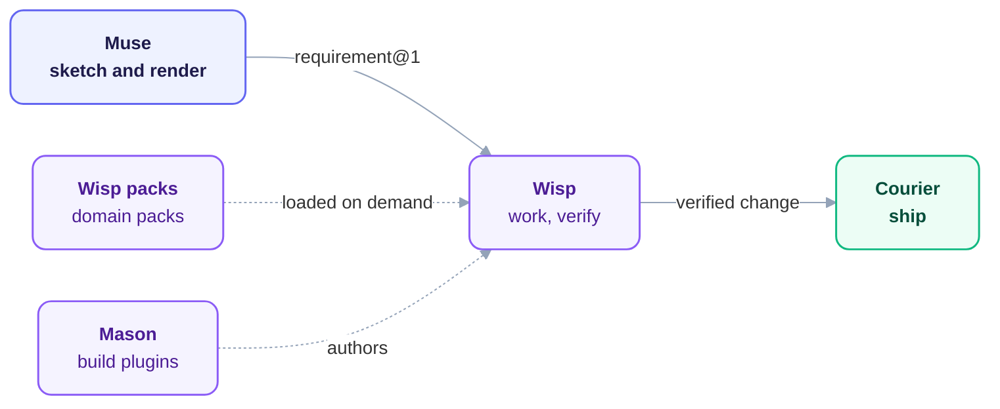

<p align="center">
  <picture>
    <source media="(prefers-color-scheme: dark)" srcset="assets/brand/hero-dark.png">
    
  </picture>
</p>

<p align="center">
  <i>Four plugins and a pack set for working with AI coding agents: a risk-aware core, shipping, exploration and plugin authoring, connected by shared JSON schemas.</i>
</p>

<p align="center">
  <b>Use this when you're building non-trivial software with AI coding agents and need to know every acceptance criterion was implemented and tested — not assumed.</b> The specific problem: agents working across long sessions silently drop criteria as context compresses. Specs live on disk. Agents read from disk. Drift is detectable, not silent.
</p>

<p align="center">
  <a href="LICENSE"></a>
  <a href="marketplace.json"></a>
  <a href="ARCHITECTURE.md"></a>
</p>

---

## Wisp Plugins — v5

Four plugins plus `wisp-packs`, together **Wisp Plugins**, the agent-side companions to the [Wisp](https://github.com/orin-dx/wisp) project-intelligence library. v5 replaces the eleven-plugin lifecycle pipeline (a plugin per stage, a handoff document between each) with one deep core and three focused plugins. The retired stages' useful content now lives inside `wisp`; their schemas stay on disk, unchanged, because published schema versions are immutable. The plugins are composable: install only what your workflow needs.



| Plugin | Job | Output |
| :--- | :--- | :--- |
| `wisp` | The core: one entry point that classifies a change by risk, does the work in full context, and runs an independent check where a confident mistake is costly | a diff or render, its evidence, and what was not verified |
| [`courier`](./plugins/courier/) | Commits, opens PRs, triages review feedback, writes changesets and release notes | `changeset@3`, `release-artifact@3` |
| [`muse`](./plugins/muse/) | Shows options before deciding: sketches and renders structurally different options, then promotes the chosen one | `option-set@1`, `requirement@1` |
| [`mason`](./plugins/mason/) | Scaffolds and audits plugins, designs schemas, and evaluates workflow behavior | `harness-evaluation@2` |
| `wisp-packs` | Domain packs that `wisp` loads when the work needs them | references loaded on demand |

---

## Install

### One Ecosystem, Two Harnesses

This repository publishes the same lifecycle ecosystem to Claude Code and Codex without pretending their runtimes are interchangeable. The durable boundary is the versioned JSON artifact in `shared/schemas/`; a requirement, research report, spec, or plan can move between harnesses when it validates against the same schema.

| Concern | Claude Code | Codex | Source of truth |
| :--- | :--- | :--- | :--- |
| Shared ID, version, author, and artifact declarations | Uses `plugins/<id>/plugin.json` | Native manifest is checked against those shared fields | `plugins/<id>/plugin.json` |
| Workflow prompts | Skills plus specialist agent prompts | Native Codex skills | Claude: `plugins/<id>/`; Codex: `harnesses/codex/plugins/<id>/` |
| Durable handoffs | Versioned JSON artifacts | The same versioned JSON artifacts, materialized as regular files | `shared/schemas/` |
| Installable marketplace | Root Claude marketplace files | Root discovery manifest plus generated bundle | `.agents/plugins/marketplace.json` and `dist/codex/` |

`plugins/` is the authored source for the existing Claude/AGY marketplace. `harnesses/codex/plugins/<id>/` contains separately authored Codex manifests, skills, and optional resources. `harnesses/codex/catalog.json` controls marketplace order and materialized runtime files only. `tools/build-codex-marketplace.py` validates and packages those inputs into `dist/codex`, then emits `.agents/plugins/marketplace.json` at the repository root so Codex can discover the bundle from Git. Do not edit generated files by hand.

Claude agents are not renamed and shipped as Codex agents. Each Codex skill has its own harness-appropriate instructions and can complete alone. When agent teams are enabled, a skill selects a packaged Codex role card for independent, bounded work; the artifact contract and single-agent result remain the same. Codex role cards are portable plugin resources, not TOML configuration.

### Claude Code

Add the repository marketplace from inside Claude Code, then install the plugins you want. `courier` ships work, `muse` explores options, `mason` authors plugins, and `wisp-packs` adds domain packs to `wisp`:

```
/plugin marketplace add orin-dx/wisp-plugins
/plugin install wisp
/plugin install courier
/plugin install muse
/plugin install mason
/plugin install wisp-packs
```

If you registered the previous marketplace identity, replace it before installing from Wisp Plugins:

```
/plugin marketplace remove orin-dx-agent-plugins
/plugin marketplace add orin-dx/wisp-plugins
```

### Codex

Codex discovers the generated root manifest at `.agents/plugins/marketplace.json`; it points at the generated `dist/codex` bundle. Register the repository once, then add only the plugins you need:

```bash
codex plugin marketplace add orin-dx/wisp-plugins
codex plugin add courier@wisp-plugins
codex plugin add muse@wisp-plugins
codex plugin add mason@wisp-plugins
```

Inspect marketplace availability with:

```bash
codex plugin list
```

To refresh the registered Git marketplace after a release:

```bash
codex plugin marketplace upgrade wisp-plugins
```

For contributors using a local checkout, rebuild and verify the bundle before registering it:

```bash
python3 tools/build-codex-marketplace.py
python3 tools/build-codex-marketplace.py --check
codex plugin marketplace add .
```

If you previously registered the marketplace as `orin-dx-agent-plugins`, migrate to the Wisp Plugins identity:

```bash
codex plugin marketplace remove orin-dx-agent-plugins
codex plugin marketplace add orin-dx/wisp-plugins
codex plugin add <plugin>@wisp-plugins
```

### Session History Across Agent Hosts

Entire-managed adapters expose the same repository-history search skill to Codex, Claude, Cursor, Gemini, and OpenCode. Cursor and OpenCode also carry host-native lifecycle hooks. These tracked files contain commands and adapter code—not session transcripts, credentials, or machine-specific paths—and should be regenerated through Entire rather than edited by hand.

### Antigravity (AGY)

Install individual plugins via the native CLI (uses a Git URL):

```bash
agy plugin install https://github.com/orin-dx/wisp-plugins.git
```

Or use [`agy-plugins-cli`](https://github.com/ZaunEkko/agy-plugins-cli) for an interactive TUI with update tracking:

```bash
npm install -g agy-plugins-cli
agy-plugin marketplace add orin-dx/wisp-plugins
agy-plugin add courier@wisp-plugins
agy-plugin add muse@wisp-plugins
agy-plugin add mason@wisp-plugins
```

---

## Design Principles

Six decisions shape how every plugin and agent in this repository is built. They are enforced by `shared/constitution.md` and explained in `shared/agent-best-practices.md`.

**Schema-Driven Development** — every handoff between agents is a typed JSON document.
- JSON Schema draft-2020-12 with `additionalProperties: false`; agents are told to conform to the cited schema, and a Claude Code hook rejects a non-conforming exit-gate `verdict@3` (other handoffs are not validated at runtime)
- Schema versions are immutable — a breaking change creates `<name>@2.json`, never mutates the existing file
- Every new schema includes a private `reasoning` scratchpad field that is never forwarded downstream

**EARS output contracts** — hard constraints live exclusively in `<output>` sections, using `WHEN / IF / WHILE / WHERE / THE SYSTEM SHALL`.
- Encodes what the agent must produce, must not produce, or must do under a specific condition
- The prompt interior — how the agent searches, reasons, and decides — is intentionally unconstrained
- EARS is the fence; goal and judgment fill the interior

**4-part agent structure** — every Claude/AGY source agent body has exactly four sections; no role labels, no success-criteria checklists. Codex skills and role cards use native structures while preserving lifecycle intent.
- `<constitution>` — ecosystem-wide invariants, byte-identical across every agent (copied verbatim, never authored per-agent)
- `<goal>` — intent, not steps
- `<judgment>` — the specific failure mode that looks like success
- `<output>` — schema reference and EARS contracts

**Cognitive mode separation** — agents are dispatched by the cognitive mode they require, not their pipeline position.
- A scanner (exhaustive pattern matching, no filtering) and an adversary (default-to-skepticism, requires a concrete failing scenario) cannot share a mental mode — combining them produces an agent worse at both
- Model and effort tiers follow the same logic: `haiku / low` for enumeration, `sonnet / medium` for analysis, `opus / high` for binding judgment

**Instruction economy** — prompts preserve decisions, evidence, and consequences while removing filler, repeated rationale, and incidental process.

- One independently actionable rule per paragraph or list item
- Numbered procedures only when order affects correctness
- Reference files hold detail needed by one phase; runtime prompts load it on demand

**Verification evidence** — a check is useful only when its observation can falsify the claim.

- Select project-native mutation, property, fuzz, race, integration, or boundary checks from the changed risk
- Derive semantic sibling candidates from domain responsibility, state transitions, and architecture—not copied syntax alone
- Record generators, oracles, coverage gaps, pending checks, fresh external state, and boundary observations where relevant

See [`ARCHITECTURE.md §7`](./ARCHITECTURE.md#7-agent-authoring-principles) for the full authoring guide.

---

## Shared Schema Contract

Structured inter-plugin handoffs are typed. Schemas live in `shared/schemas/` and use JSON Schema draft-2020-12 with `additionalProperties: false`. Schema versions are immutable — a breaking change requires a new file (e.g. `requirement@2.json`). Every new schema includes a `reasoning` scratchpad field that is never forwarded downstream (`candidate@1` and `implementation-context@1` predate the rule).

| Schema | Produced by | Consumed by |
| :--- | :--- | :--- |
| `requirement@1` | muse promote | the `wisp` work skill |
| `option-set@1` | muse sketch | muse promote, humans |
| `spike-report@1` | a spike (`wisp`) | muse promote, humans |
| `changeset@3` | courier | courier release |
| `release-artifact@3` | courier | humans |
| `evaluation-run@1` | mason evaluation runner | mason evaluation adjudicator |
| `harness-evaluation@2` | mason | release reviewers and longitudinal analysis |

The schemas of the retired plugins (`research-report@1`, `spec@1`, `plan@1`, `finding-report@2`, `implementation-review@2` and the rest) stay on disk unchanged; the `wisp` plugin reuses the ones its work needs.

Every gate produces `verdict@3`. `verdict@1` is retained unchanged for artifacts that already use it; immutable schema versions are not rewritten in place.

---

## Shared References

Shared guides live in `shared/references/`. Paths start with the decision they support; language is the filename only when evidence is language-specific. Runtime instructions load exact files, while maintainers use the index and authoring-only guides directly.

| Concern | Supports |
| :--- | :--- |
| `hazards/` | Candidate defect signals and boundary tracing |
| `architecture/` | Semantic models, structural causes, and remediation |
| `verification/` | Evidence selection, project-native checks, review, and interface coverage |
| `delivery/` | Changesets, commits, pull requests, and review operations |
| `authoring/` | Reader-focused prose, comments, and diagrams |
| `evaluation/` | Hidden-oracle behavioral comparison |
| `workspace/` | Persisted artifact locations |
| `tooling/` | Repository tool preferences |

See [`shared/references/README.md`](./shared/references/README.md) for the maintainer map.

---

## Repository Structure

```
wisp-plugins/
├── marketplace.json              ← Plugin registry
├── .claude-plugin/               ← Claude marketplace metadata
├── ARCHITECTURE.md               ← System architecture
├── CONTRIBUTING.md               ← Plugin authoring guide
├── harnesses/
│   └── codex/
│       ├── catalog.json          ← Marketplace order and runtime dependencies
│       └── plugins/<id>/         ← Authored native Codex plugins and skills
├── shared/
│   ├── schemas/                  ← Versioned inter-agent JSON schemas
│   ├── references/               ← Runtime and authoring guides, split by concern
│   ├── hooks/                    ← Claude Code hooks: gate handback validator
│   └── agent-best-practices.md  ← Authoring-time principles
├── plugins/
│   ├── wisp/                      ← Core: risk-aware work and independent check
│   ├── wisp-packs/                ← Domain packs loaded by wisp
│   ├── courier/                   ← Ship tooling
│   ├── muse/                      ← Sketching and promotion
│   └── mason/                     ← Plugin authoring and behavioral evaluation
├── .agents/
│   ├── plugins/                   ← Generated Codex discovery manifest; never hand-edit
│   └── skills/entire-search/      ← Entire-managed Codex history search
├── .claude/skills/entire-search/  ← Entire-managed Claude history search
├── .cursor/                       ← Entire-managed Cursor skill and hooks
├── .gemini/skills/entire-search/  ← Entire-managed Gemini history search
├── .opencode/                     ← Entire-managed OpenCode skill and plugin
├── tools/
│   └── build-codex-marketplace.py ← Deterministic Codex bundle generator
└── dist/codex/                    ← Generated Codex bundle; never hand-edit
```

---

## License

MIT © Gabriel Castro (Orin DX)
