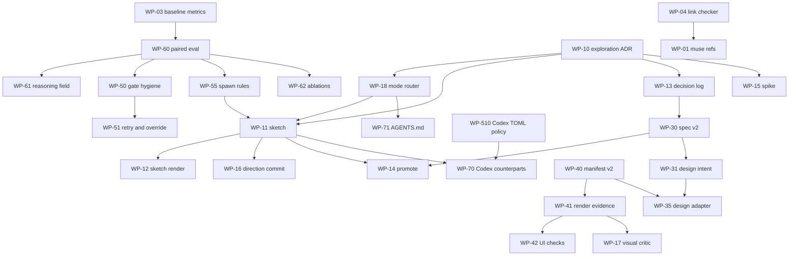

# Work-package catalog (consolidated)

Inputs: WP-draft.md (60 WPs) plus proposed WPs from MAP-1 (12), MAP-2 (15), MAP-3 (18), MAP-4 (21), MAP-5 (18). Total 144 WPs, none renumbered, none deleted. 8 are marked merged-into (their scope is kept in the surviving WP; the id stays valid for the matrices).

Conventions used in the table
- Evidence = number of matrix table rows (lines starting with `|`) in MAP-1..5 that contain the id. WP-112, WP-510, WP-517, WP-518 show 0 because they were only introduced in the proposal sections.
- ADR column: `amends N` means an accepted ADR's guardrail is touched (the record is not rewritten; per docs/adr/README.md it is marked or superseded by a new one). `new N1..N10` are the proposed new ADRs listed in section 3.2. `none` means a constitution/docs change that needs no ADR.
- Schema column: a new schema or schema version is needed (ADR 004: published schemas are immutable, add `@n+1`). Bundle all bumps in one release (spec@2, plan@2, verdict@4, workspace-manifest@2, requirement@2) to limit consumer churn.
- Codex column: Y if a skill, agent, schema, or route changes (harness-authoring.md: read the counterpart, record the change record, run `just marketplace-sync`). N for docs, tooling, eval, research, and consumer-repo work. Codex role cards are markdown resources, not TOML (see conflict K9).
- Size: S under 1 day, M 1 to 3 days, L over 3 days or multi-plugin.
- W = proposed wave (0 to 5), see section 3.

## 1. Catalog

| id | group | title | scope | target | type | ADR | schema | Codex | size | depends-on | evid | merge note | W |
| :-- | :-- | :-- | :-- | :-- | :-- | :-- | :-- | :-- | :-- | :-- | --: | :-- | --: |
| WP-01 | G0 | Fix dangling ranger a11y taxonomy refs in muse | Correct plugin.json, README, SKILL.md that cite a non-existent ranger accessibility hazard pack; fix docs now or point at WP-44. | plugins/muse, harnesses/codex/muse | docs | none | N | Y | S | WP-04 (detects it) | 4 | overlaps WP-44; keep both because 01 is the docs defect, 44 is the optional feature | 0 |
| WP-02 | G0 | Migrate muse verdict@1 to verdict@3 | Move muse exit-gate and routing to verdict@3, bump plugin version, update Codex route. | plugins/muse, shared/schemas | schema | none (ADR 004 satisfied by using existing @3) | N (uses existing @3) | Y | S | none | 3 | none | 0 |
| WP-03 | G0 | Transcript baseline metrics script | Measure gate rounds per spec, blocker type (wording vs substantive), time-to-first-visual, post-gate defects, stalls, tokens/cost per phase; count passes not agents. | tools/ (new script), mason:evaluate input | tooling | none | N | N | M | none | 35 | WP-91 merged into this | 0 |
| WP-04 | G0 | Cross-reference link checker | Fail `just check` and mason:audit-plugin when plugin docs cite files, agents, or packs that do not exist. | justfile, scripts/, plugins/mason | tooling | none | N | N | S | none | 4 | overlaps WP-440 and WP-508; keep all three, share one script (04 internal refs, 440 external URLs/size, 508 authoring limits) | 0 |
| WP-05 | G0 | Verify factual claims in repo docs | Re-count agents, schemas, tier tables, line citations touched by this evaluation (e.g. 29 of 31 schemas, 44 agents). | docs/, README, constitution | docs | none | N | N | S | none | 4 | none | 0 |
| WP-10 | G1 | ADR: exploratory/divergent cognitive mode | Record that a non-binding divergent mode (sketch/spike) is allowed beside the 7 modes; defines mode routing and non-binding artifacts. | docs/adr, shared/constitution.md | constitution | amends 003 (new N1) | N | Y | M | WP-03 evidence | 24 | none | 1 |
| WP-11 | G1 | muse `sketch` skill | Option files with stable IDs, status, one-line reason, anchor brief, default option cap, TBDs allowed, no gate, low-fidelity marker, hard stop before implementation, scratch-dir write guard. | plugins/muse (new skill+agent), harnesses/codex/muse | new-skill | N1 | maybe sketch-option@1 | Y | L | WP-10, WP-18 | 60 | overlaps WP-16 on option count (conflict K1); keep both: 11 is the workflow, 16 is direction/anti-slop control | 1 |
| WP-12 | G1 | Sketch rendering medium and option matrix | Local-first dev server/static pages, repo Playwright scripts, side-by-side boards, brand x theme x viewport matrix from tokens; Artifacts opt-in only (user stopped using them). | plugins/muse references | new-skill | N1 | N | Y | M | WP-11 | 42 | none | 1 |
| WP-13 | G1 | Decision log and cross-session persistence | Status-bearing decision log in consumer repos, routed via AGENTS.md, detects recorded-but-not-applied, rule candidates pending human acceptance. | shared/schemas/decision-log@1 (new), muse, docs | schema | new N7 (relation to ADR table) | Y (new) | Y | L | WP-10 | 40 | overlaps WP-201, WP-412, WP-414; keep all because 13 is the store, 201 orchestrator entries, 412 promotion ladder, 414 harvest | 1 |
| WP-14 | G1 | `promote` skill: sketch to requirement to spec | Turn chosen prototype into requirement@1/spec@2 with screenshot oracle, change-delta, decision_ref, TBDs resolved or moved to non_goals. | plugins/muse or scribe (new skill) | new-skill | N1 | uses spec@2 (WP-30) | Y | L | WP-11, WP-30 | 37 | overlaps WP-304 (bundle format); keep both: 14 is the skill, 304 the handoff bundle | 3 |
| WP-15 | G1 | smith `spike` skill | Throwaway validation of a tool or approach; skips plan/spec/mutator/reviewer/exit-gate; reports verified vs unverified; promote or discard. | plugins/smith (new skill) | new-skill | N1 | N | Y | M | WP-10, WP-18 | 8 | none | 1 |
| WP-16 | G1 | Direction-commit and anti-slop controls | Propose distinct directions, user picks, named aesthetic, ban lists, rejection clauses, taste dials, deterministic slop scanner. | plugins/muse, shared/references/design | new-skill | N1 | N | Y | M | WP-11 | 43 | overlaps WP-11 (option count K1), WP-409 (technique catalog); keep: 16 is the product behavior | 1 |
| WP-17 | G1 | Visual critique / design-review agent | Playwright multi-viewport critic, P0-P3 severity, user-impact language with screenshots; distinct from spec audit. | plugins/muse (new agent) | new-agent | N1 (new cognitive role) | N | Y | L | WP-41, WP-53 | 40 | overlaps WP-206, WP-404, WP-437; keep: they feed 17's checks | 3 |
| WP-18 | G1 | Mode router | shape/sketch/spike/implement/review/copy/harden/promote with per-mode gate set, authority labels ("cleared by"), explicit enter/leave gated mode. | plugins/muse and shared router reference, AGENTS.md | new-skill | N1 | N | Y | M | WP-10 | 61 | overlaps WP-309 and WP-208 (fast path); keep 18 as router | 1 |
| WP-19 | G1 | Exploration to hardening handoff | Characterization tests, behavior pinning, hardening checklist (states, a11y, copy truth, responsive); harden mode keeps direction. | plugins/smith, muse references | new-skill | N1 | N | Y | M | WP-15 or WP-11 | 18 | none | 1 |
| WP-20 | G1 | Copy/voice workflow | Copy review skill/agent, case-study truth audit, voice consistency, provenance with WP-43. | plugins/muse (new skill) | new-skill | N1 | N | Y | M | WP-43 | 14 | WP-215 merged into this | 3 |
| WP-21 | G1 | Design research via vanguard | Visual/competitive sourcing, prior-art boards, keep recon-reader-synthesizer; sharper framing. | plugins/vanguard references | docs | none | N | Y | S | none | 10 | none | 1 |
| WP-30 | G2 | ADR + spec@2 | Token references `{path}`, visual references (Figma node, story id, screenshot), per-state render refs, decision_ref, supersedes; criteria stay falsifiable; TBD banned in spec. | shared/schemas/spec@2, scribe, muse, navigator | schema | new N2 (supersedes nothing; new version per 004) | Y spec@2 | Y | L | WP-13, WP-106 | 41 | none | 3 |
| WP-31 | G2 | Design-intent artifact | Routed small files: DESIGN.md-compatible tokens, prose, Do/Don't, rejection clauses, coverage-gaps, exemplars; optional lint/export; lookup not monolith. | shared/schemas/design-intent@1, muse, docs | schema | N2 | Y (new) | Y | L | WP-30 | 59 | overlaps WP-403 (generated outputs) and WP-302 (provenance field); keep all | 3 |
| WP-32 | G2 | Ground-truth extraction in recon | Extract tokens, props, measured geometry from repo/page/prototype into a facts file; compile examples; version-tied. | smith:recon, muse recon | new-agent | N3 | maybe via manifest@2 | Y | L | WP-40 | 28 | overlaps WP-312; keep: 32 facts, 312 reuse inventory | 3 |
| WP-33 | G2 | Reference tables before drafting | ARIA APG patterns, keyboard maps, platform a11y APIs; "never write from memory". | shared/references/accessibility, muse drafter | docs | none | N | Y | M | none | 11 | none | 3 |
| WP-34 | G2 | Human-reviewable spec rendering | Dual format (JSON + readable), approval boards, show before approval. | muse, scribe | new-skill | none | N | Y | M | WP-12, WP-30 | 23 | overlaps WP-211; keep | 3 |
| WP-35 | G2 | Design-source adapter | design-source@1 (figma/screenshot/html/description/none), capability-detected Figma and Storybook MCP, token/component reuse checks, rules generator. | muse (new agent), shared/schemas | new-agent | N2 | Y (new) | Y | L | WP-31, WP-303, WP-317 | 59 | none | 3 |
| WP-36 | G2 | Spec/plan size and stall guards | Size caps, chunked writes, split specs, supersession and stale-spec cleanup. | scribe, navigator, constitution | constitution | none | N | Y | M | WP-54 | 18 | overlaps WP-310 (proportionality); keep: 36 mechanics, 310 policy | 2 |
| WP-40 | G3 | ADR + workspace-manifest@2 | Capability kinds browser/visual/a11y/storybook/e2e; unrendered UI is a coverage gap, never a pass; keeps ADR 005. | shared/schemas/workspace-manifest@2, ranger/smith recon | schema | new N3 (cites 005 as kept) | Y | Y | M | none | 22 | none | 3 |
| WP-41 | G3 | render-evidence artifact | Screenshots per viewport/theme/state, axe/Lighthouse JSON, console errors, a11y trees; baseline approval step. | shared/schemas/render-evidence@1, smith, sentinel | schema | N3 | Y (new) | Y | L | WP-40 | 48 | none | 3 |
| WP-42 | G3 | Deterministic UI checks | Token lint, computed styles, contrast/target-size/reflow, landmarks, size budget; forced colours and reduced motion; automated a11y coverage is partial. | shared/references/verification, smith recipe | tooling | none | N | Y | L | WP-41 | 62 | WP-112 merged into this | 3 |
| WP-43 | G3 | Copy-provenance check | Rendered text vs source copy; invented stats/names; quoted evidence plus location. | smith/sentinel recipe, scanner | new-agent | none | N | Y | M | WP-41 | 14 | none | 3 |
| WP-44 | G3 | ranger a11y hazard pack for TSX/CSS | Build the pack (or cut refs, WP-01); hazards for focus, labels, roles. | plugins/ranger, shared/references/hazards | new-skill | none | N | Y | L | WP-101 | 5 | overlaps WP-101 (applicability notes); keep: 44 pack, 101 TS reference additions | 3 |
| WP-45 | G3 | Visual-regression and CI policy | Playwright/Storybook/axe in CI, baseline approval, behavior-vs-CSS test policy, Chromatic/Percy/Lost Pixel options. | shared/references/verification, docs | docs | none | N | N | M | WP-41 | 28 | overlaps WP-80 (consumer-repo instance) | 3 |
| WP-46 | G3 | smith UI verification recipe | Component/DOM tests, Storybook interaction, Playwright, mutation limits for markup/CSS, sibling review. | plugins/smith references | docs | none | N | Y | M | WP-40 | 21 | none | 3 |
| WP-47 | G3 | UI code-intelligence query layer | Computed style, a11y tree, token usage, component usage extending language-service evidence (f10e6b8). | shared/references/tooling, smith | tooling | none | N | Y | L | WP-41 | 11 | none | 3 |
| WP-50 | G4 | Gate-hygiene constitution amendment | Blockers cite evidence, "no findings" is a valid pass, mechanical fixes outside the gate, convergence control, scanners report all then filter. | shared/constitution.md, all exit-gates | constitution | new N4 | N (verdict@4 only if WP-212 lands) | Y | M | WP-03, WP-60 (test K2) | 36 | overlaps WP-310 and WP-413 (same constitution pass); keep, land together | 2 |
| WP-51 | G4 | Retry-cap enforcement and override logging | Real human escalation after cap; declared and logged overrides, no silent "owner-directed pass". | exit-gates, orchestrator skills, constitution | constitution | N4 | maybe verdict@4 override field | Y | M | WP-50 | 21 | overlaps WP-201 (decision ledger); keep: 51 gate overrides, 201 all orchestrator calls | 2 |
| WP-52 | G4 | Readback and shared-contract-first | Readback in correction loop, shared contract before sibling specs, cross-spec contradiction checks, pilot-spec-first. | scribe, muse, constitution | constitution | none | N | Y | M | none | 13 | none | 2 |
| WP-53 | G4 | Standard vocabulary and urgency tiers | Closed vocabulary for status/replies and P0-P3 definitions; A/B vs free text (WP-514). | shared/references/authoring, constitution | constitution | none (EARS stays in outputs, ADR 002) | N | Y | S | WP-514 | 7 | overlaps WP-513 (named procedures); keep | 2 |
| WP-54 | G4 | Stall and lost-contact procedures | Per-agent timeouts, fallbacks, go-around, chunked writes. | orchestrator skills, constitution | constitution | none | N | Y | M | WP-03 | 9 | none | 2 |
| WP-55 | G4 | Orchestrator-owned spawning and parallel rules | No agent spawns its own verifiers, spawn caps, file ownership in plans, single writer for shared tokens, one merge at a time, post-merge render check, worktrees, ceiling. | constitution, navigator, smith:implement | constitution | new N5 | N | Y | L | WP-60 pilot | 30 | WP-214 merged into this; overlaps WP-425, WP-407 | 2 |
| WP-56 | G4 | Investigate unused agents | Why smith reviewer/mutator/exit-gate/recon, sentinel, scribe:verifier/arch-auditor, muse:auditor were skipped; integrate or simplify. | plugins/smith, scribe, muse, sentinel | research | maybe N4 | N | Y | M | WP-03 | 9 | none | 0 |
| WP-57 | G4 | Scoped pre-commit cost | Guidance and checks so parallel smith runs do not pay repo-wide gates per commit. | smith:implement, hooks | docs | none | N | Y | S | WP-55 | 5 | overlaps WP-512 (pre-commit scoping); keep | 2 |
| WP-58 | G4 | Plan quality | Stale geometry, plan amend on spec change, challenger checks live code contradictions. | navigator planner/challenger | new-agent | none | N | Y | M | WP-30 | 10 | none | 2 |
| WP-60 | G5 | mason:evaluate paired-eval harness | Replay, smoke, k=3, full; per-task medians, Wilcoxon, failure exclusion, bill-based, outcome-graded. | plugins/mason, shared/references/evaluation | eval | none | maybe harness-evaluation@3 | Y | L | WP-03 | 28 | overlaps WP-514 (methodology), WP-311, WP-405; keep | 0 |
| WP-61 | G5 | `reasoning` field refusal test | Reproduce refusals with/without field; prompt-only reframe now, @n+1 later; 29 of 31 schemas. | shared/schemas, agents | research | new N6 (ADR 004) | maybe @n+1 across schemas | Y | M | WP-60 | 6 | WP-518 merged into this (priority promotion) | 0 |
| WP-62 | G5 | Ablate constitution, backstory, skeleton | Measure with cache hits netted; decide on ADR 001/006 and static prefix. | agents, constitution | eval | maybe amends 001, 006 (N10) | N | Y | L | WP-60 | 12 | none | 4 |
| WP-63 | G5 | Tier and effort re-check | Haiku 5.5 recon, Opus 5.5 gates medium vs high, Fable trial, GPT mapping not mechanical (harness-authoring). | constitution tiers, agents | eval | none | N | Y | M | WP-60, WP-501 | 32 | overlaps WP-501 (policy); keep | 4 |
| WP-64 | G5 | Prescriptiveness audit | Ration MUST/ALWAYS, explain "never X", remove "think carefully", model-conditioned over-verification. | all agents | docs | maybe N10 | N | Y | L | WP-62 | 32 | overlaps WP-503, WP-504, WP-507; keep | 4 |
| WP-65 | G5 | Narration brevity | "Be concise" for status/rationale only, never specs or handoffs, not telegraphic style. | skills, orchestrators | eval | none | N | Y | S | WP-60 | 10 | none | 4 |
| WP-66 | G5 | Context management | Structured JSON state, progress notes, git, fresh context vs compaction. | shared/references/authoring | docs | none | N | Y | M | none | 14 | none | 4 |
| WP-67 | G5 | Skill-rule evals for design skills | Hidden-oracle fixtures on unseen interfaces. | plugins/mason fixtures | eval | none | N | Y | M | WP-16, WP-60 | 9 | overlaps WP-109 and WP-405; keep | 3 |
| WP-68 | G5 | Token-saver paired test (rtk) | Paired measurement on user's workflow; user config untouched. | tools/, mason | research | none | N | N | S | WP-516, WP-60 | 7 | none | 5 |
| WP-70 | G6 | Codex counterparts for all new skills/agents | Outcome-first wording, boundaries, stop conditions, role cards, sandbox read-only, marketplace-sync; wording "TOML subagents" corrected by WP-510. | harnesses/codex | docs | maybe N8 | N | Y | L | per-WP (rolling) | 41 | overlaps WP-510; keep: 70 is the umbrella checklist applied per WP | 4 |
| WP-71 | G6 | AGENTS.md strategy | Short router, size budget, CLAUDE.md pointer, nested override, three layers. | AGENTS.md, consumer repos, docs | docs | new N8 | N | Y | M | WP-18 | 29 | overlaps WP-440 (size/validity lint) | 4 |
| WP-72 | G6 | Skills versioning and maintenance | Examples compile, source-version-tied review, mechanical vs judgment repair, CI surfaces without auto-fix. | tooling, mason | tooling | new N9 | N | Y | L | WP-508 | 16 | overlaps WP-403 and WP-408; keep | 4 |
| WP-73 | G6 | Drift for intent/facts/decision logs | Extend spec-drift to new artifact kinds and docs freshness. | scribe:spec-drift | new-agent | none | N | Y | M | WP-13, WP-31, WP-32 | 19 | none | 3 |
| WP-74 | G6 | Design-system lookup interface | CLI vs MCP, JSON over Markdown, llms.txt, component manifests. | shared/references/design | research | none | N | Y | M | WP-402 | 32 | overlaps WP-403, WP-213; keep | 4 |
| WP-80 | G7 | Consumer CI: Playwright/Storybook/axe | Restore visual/a11y checks deferred 13 Oct, screenshot assertions. | consumer repo | consumer-repo | none | N | N | M | WP-45 | 13 | none | 5 |
| WP-81 | G7 | Consumer duplicate abstractions | orin vs twx packages, ui vs components, css() usage, brand branches, unported rules. | consumer repo | consumer-repo | none | N | N | L | none | 8 | none | 5 |
| WP-82 | G7 | Consumer decision/spec cleanup | Decision status staleness, spec supersession cleanup, copy truth, SEO. | consumer repo | consumer-repo | none | N | N | M | WP-110, WP-43 | 10 | none | 5 |
| WP-90 | G8 | Verify unverified claims and sources | Open 403 pages, unfetched sources, uSpec, DESIGN.md docs, Figma, ICAO; resolve C-11. | docs/research | research | none | N | N | M | WP-401 | 90 | none | 0 |
| WP-91 | G8 | Gate cost measurement | Tokens/time per gate round. | tools/ | tooling | none | N | N | S | WP-03 | 11 | merged into WP-03 (same transcript pipeline) | 0 |
| WP-101 | MAP-1 | TSX/CSS hazard applicability notes | UI sections in typescript hazard refs (T7 props dropped, T9 variants, focus return). | shared/references/hazards | docs | none | N | Y | S | none | 2 | overlaps WP-44; keep | 3 |
| WP-102 | MAP-1 | UI state-modelling reference | Sum types for component states, loading/error/empty; loaded by muse drafter. | <refs>/architecture/ui-state.md | docs | none | N | Y | S | none | 1 | none | 3 |
| WP-103 | MAP-1 | plan@2 render-evidence task kind | Task verification may be render-evidence reference. | shared/schemas/plan@2, navigator | schema | N2 | Y plan@2 | Y | M | WP-30, WP-41 | 1 | none | 3 |
| WP-104 | MAP-1 | weaver exploratory intake | requirement status exploratory (or brief@1), optional done_when, clarifier bypass. | plugins/weaver, schemas | schema | none | Y requirement@2 or brief@1 | Y | M | WP-18 | 1 | none | 1 |
| WP-105 | MAP-1 | Rendered-text and link crawl probe | Scan for NaN, undefined, [object Object], dead links, missing lang/description. | shared/references/verification, smith/sentinel | tooling | none | N | Y | S | WP-42 | 2 | overlaps WP-111; keep: 105 probe, 111 recipe | 3 |
| WP-106 | MAP-1 | Criterion brittleness guard | Route visual facts to token/render oracles, not pinned px/hex; AC size caps. | muse drafter/auditor, spec rules | docs | none | N | Y | M | none | 4 | overlaps WP-310, WP-204; keep | 2 |
| WP-107 | MAP-1 | Oracle independence rule | Thresholds derived from spec/token source, never implementation constants. | smith, navigator challenger, verification/evidence.md | docs | none | N | Y | S | none | 1 | none | 2 |
| WP-108 | MAP-1 | Design-decision revision loop | Batch design revisions through correction mode with revision_note and mandatory re-gate; detect modified-after-pass via hash. | scribe:correct-spec, muse | new-skill | none | uses spec@2 | Y | M | WP-30 | 1 | WP-202 merged into this | 2 |
| WP-109 | MAP-1 | Defect-corpus replay fixtures | Hidden-oracle fixtures from D-11..D-27 defect classes. | plugins/mason | eval | none | N | Y | M | WP-60 | 2 | none | 0 |
| WP-110 | MAP-1 | Live-contract view and spec ID scheme | Resolve "Replaces AC-xxx" chains and suffixes to current view. | scribe tooling, spec-drift | tooling | none | uses spec@2 | Y | M | WP-30 | 1 | none | 3 |
| WP-111 | MAP-1 | Ship-readiness recipe | Checklist (crawl, SEO, links, size, landmark/lang, copy provenance) yielding scoped verdict@3. | sentinel or courier:release | new-skill | none | N | Y | M | WP-105, WP-43 | 3 | none | 3 |
| WP-112 | MAP-1 | Forced-colours and reduced-motion probes | Addition to WP-42's list. | WP-42 | tooling | none | N | N | S | WP-42 | 0 | merged into WP-42 | 3 |
| WP-201 | MAP-2 | Orchestrator decision ledger | Orchestrator unblock decisions logged as pending human confirmation, batched. | constitution, shared/references/orchestration | constitution | N7 | N | Y | M | WP-13, WP-51 | 3 | overlaps WP-51; keep | 2 |
| WP-202 | MAP-2 | Delta gate for post-prototype revisions | Light gate on changed criteria and siblings; skip declared. | muse/scribe gates | constitution | none | N | Y | M | WP-108 | 6 | merged into WP-108 (same revision-then-regate loop) | 2 |
| WP-203 | MAP-2 | Defect-vs-spec routing rule | E2E defect: decision record picks fix-code vs correct-spec; no silent spec exemption. | smith:implement, scribe:correct-spec | constitution | none | N | Y | S | none | 1 | none | 2 |
| WP-204 | MAP-2 | Test taxonomy and retarget-on-redesign | Tag criteria/tests behavior/layout/visual; redesign re-greens visual only, as delta. | navigator plan schema, smith | schema | none | Y plan@2 field | Y | M | WP-46, WP-103 | 5 | overlaps WP-106; keep | 3 |
| WP-205 | MAP-2 | Handback completeness check | Drafters write to disk, orchestrator validates report completeness against schema. | shared/references, muse/scribe drafters | constitution | none | N | Y | S | none | 5 | none | 2 |
| WP-206 | MAP-2 | Measured-geometry diff and nudge guard | Measure rendered geometry vs prototype numbers; batch after 3 micro-turns. | muse design-review (WP-17), tooling | tooling | none | N | Y | M | WP-17, WP-41 | 6 | none | 3 |
| WP-207 | MAP-2 | Design-rules preflight | Executable consumer rules run before declaring UI done; recon detects them. | smith recon/implement, manifest@2 | tooling | N3 | via manifest@2 | Y | M | WP-40 | 2 | overlaps WP-42; keep: 207 consumer-owned rules, 42 generic probes | 3 |
| WP-208 | MAP-2 | Quick-fix lane | Trivial fixes skip agents/specs/measurement fans. | router (WP-18) | constitution | none | N | Y | S | WP-18 | 1 | merged into WP-309 (same small-change rule) | 1 |
| WP-209 | MAP-2 | Stack-decision precondition | Component drafting blocks until library/stack decided; stack change triggers supersession sweep. | muse/scribe drafter, scribe:architect | constitution | none | N | Y | S | none | 2 | none | 2 |
| WP-210 | MAP-2 | Long-pipeline status protocol | Periodic status/ETA, no parked questions, user may work elsewhere. | constitution orchestrator section | constitution | none | N | Y | S | WP-53 | 2 | overlaps WP-54; keep | 2 |
| WP-211 | MAP-2 | Show-first rule | Render before describing when user asks for options/approval; trigger phrases. | muse SKILL.md, sketch | constitution | none | N | Y | S | WP-11 | 8 | overlaps WP-34; keep | 1 |
| WP-212 | MAP-2 | Gate non-monotonicity detection | Separate fix-induced blockers from late-found old issues; regression-only re-check. | exit-gate agents, verdict schema | schema | N4 | Y verdict@4 | Y | M | WP-50 | 3 | none | 2 |
| WP-213 | MAP-2 | Spec lookup skill | Answer "what does the spec say about X" with cited criteria. | scribe or muse skill | new-skill | none | N | Y | S | none | 1 | overlaps WP-74; keep | 3 |
| WP-214 | MAP-2 | Worktree isolation for parallel implementers | Worktree per parallel batch. | smith:implement | docs | N5 | N | Y | S | WP-55 | 2 | merged into WP-55 | 2 |
| WP-215 | MAP-2 | Verbatim-user-voice brief for copy agents | Quoted user statements with provenance; fact-checker confirms. | copy skill (WP-20) | docs | none | N | Y | S | WP-20 | 2 | merged into WP-20 | 3 |
| WP-301 | MAP-3 | Design-token interchange policy | Adopt W3C DTCG as canonical token JSON; map DESIGN.md export, Style Dictionary, Tokens Studio. | <refs>/design/tokens.md | docs | N2 | feeds spec@2 | N | S | WP-30 | 6 | none | 3 |
| WP-302 | MAP-3 | Provenance/licensing of intent inputs | Tag facts authoritative vs inferred; license check before vendoring. | design-intent schema, vanguard | schema | N2 | field in design-intent@1 | Y | S | WP-31 | 5 | none | 3 |
| WP-303 | MAP-3 | Figma MCP operational reference | Tool inventory with date, endpoints, limits, metadata-first, treat output as reference. | <refs>/tooling/figma-mcp.md | docs | none | N | Y | S | WP-90 | 18 | none | 3 |
| WP-304 | MAP-3 | Chosen-option handoff bundle | Bundle chosen option, tokens, decision log, oracle, prompt. | muse promote, schema | schema | N1 | Y (new) | Y | M | WP-14, WP-13 | 5 | overlaps WP-14; keep | 3 |
| WP-305 | MAP-3 | Exploration cost telemetry | Tokens/time per round, option cap, budget warning. | muse sketch, mason | tooling | none | N | Y | S | WP-03, WP-11 | 3 | none | 1 |
| WP-306 | MAP-3 | Option divergence and re-anchoring | Check options differ on declared axes; re-anchor after N revisions. | muse sketch | docs | none | N | Y | S | WP-11 | 3 | none | 1 |
| WP-307 | MAP-3 | Browser-evidence modality policy | a11y tree/DOM first, screenshots for visual claims, JSON audits. | <refs>/verification/browser-evidence.md | docs | none | N | Y | S | none | 3 | none | 3 |
| WP-308 | MAP-3 | Hook-based deterministic enforcement | Stop/pre-commit hooks run render evidence, token lint, copy check. | harnesses docs, smith | tooling | N5 | N | Y | M | WP-41, WP-42 | 1 | merged into WP-512 (same hook mechanism) | 2 |
| WP-309 | MAP-3 | Small-change fast path | Skip spec/plan for one-sentence diffs with criteria and audit trail. | sentinel/navigator routing, router | constitution | none | N | Y | S | WP-18 | 5 | absorbs WP-208 | 1 |
| WP-310 | MAP-3 | Spec proportionality and dedupe | Criteria ceiling per change size, no restating code. | constitution (with WP-50), scribe/muse auditors | constitution | N4 | N | Y | S | WP-50 | 5 | overlaps WP-106, WP-36; keep | 2 |
| WP-311 | MAP-3 | Run-to-run variance measurement | Repeat same spec N times, compare. | mason:evaluate | eval | none | N | N | S | WP-60 | 1 | extends WP-60; keep | 4 |
| WP-312 | MAP-3 | Reuse-before-create inventory | Recon inventory of components/tokens; implementer cites reuse or justifies new. | smith/muse recon, manifest@2 | new-agent | N3 | via manifest@2 | Y | M | WP-40 | 5 | overlaps WP-32; keep | 3 |
| WP-313 | MAP-3 | Tool landscape reference | Claude Design, Stitch, v0, Make, Kiro, Spec Kit, etc. with dates and re-verify triggers. | docs/ | docs | none | N | N | S | WP-90 | 13 | none | 5 |
| WP-314 | MAP-3 | Wireframe/IA option type | Sitemap/wireframe options before visuals. | muse sketch | docs | none | N | Y | S | WP-11 | 2 | none | 1 |
| WP-315 | MAP-3 | Annotation and feedback intake | Element-anchored comments persisted in files, batched per round. | muse sketch references | docs | none | N | Y | S | WP-11 | 7 | none | 1 |
| WP-316 | MAP-3 | Motion spec and verification | Motion tokens, timing, reduced-motion criteria in spec@2; probes. | muse drafter/auditor, references | docs | none | uses spec@2 | Y | S | WP-30, WP-42 | 2 | none | 3 |
| WP-317 | MAP-3 | Untrusted design-source content | Design files, DESIGN.md, MCP, scraped content are data; confirmation for writes. | constitution (Trust Boundaries), adapter | constitution | N5 | N | Y | S | none | 3 | none | 2 |
| WP-318 | MAP-3 | Wiring-truth probe | Verify UI actions hit endpoints, persist, survive reload. | smith UI recipe | docs | none | N | Y | S | WP-46 | 1 | extends WP-19; keep | 3 |
| WP-401 | MAP-4 | Evidence-quality convention | Tags [P]/[S]/[U]/[I], flag vendor benchmarks and small n. | shared/references/research, vanguard | docs | none | N | Y | S | none | 20 | none | 0 |
| WP-402 | MAP-4 | Design-context delivery benchmark | Paired test none/skill/MCP/CLI/DESIGN.md on own repo; token metric. | mason:evaluate | eval | none | N | N | M | WP-60 | 13 | none | 4 |
| WP-403 | MAP-4 | Typed schema-as-canonical source | One structured source generates DESIGN.md, llms.txt, MCP, skills. | shared/references/design, docs | docs | none | N | N | M | WP-31, WP-74 | 1 | overlaps WP-31, WP-72; keep | 4 |
| WP-404 | MAP-4 | Weighted UI audit rubric | Severity-weighted numeric audit. | muse audit-ui skill or ranger pack | new-skill | none | N | Y | M | WP-17, WP-42 | 1 | overlaps WP-17; keep | 3 |
| WP-405 | MAP-4 | Conformance scoring harness | Score generated UI vs real components. | mason fixtures | eval | none | N | N | M | WP-60 | 1 | overlaps WP-109; keep | 4 |
| WP-406 | MAP-4 | Human-trigger-only skill policy | Criteria for disable-model-invocation; Codex expression. | constitution, mason:audit-plugin | constitution | none | N | Y | S | none | 1 | none | 4 |
| WP-407 | MAP-4 | Agent trust tiers and capped outputs | Tiers by capability, safe-outputs. | constitution | constitution | N5 | N | Y | M | WP-55 | 4 | overlaps WP-55; keep | 2 |
| WP-408 | MAP-4 | Skill distribution and discovery | npm package, /.well-known/skills, mirrored dirs. | docs/adr, harnesses/codex | docs | new N9 | N | Y | M | WP-72 | 3 | overlaps WP-72; keep | 4 |
| WP-409 | MAP-4 | Coercion-technique reference | Catalog of prompt techniques with when-to-use. | shared/references/prompting | docs | none | N | N | S | none | 10 | overlaps WP-507; keep | 4 |
| WP-411 | MAP-4 | Introspection and dry-run conventions | `info --json` / `--dry-run`, validation tool, final-lint step. | smith:recon, tooling/cli.md | docs | none | N | Y | S | none | 4 | none | 4 |
| WP-412 | MAP-4 | Rule promotion ladder | Guidance -> exemplar -> lint -> eval fixture, human acceptance. | shared/references/design | docs | N7 | N | Y | S | WP-13 | 5 | overlaps WP-13, WP-414 | 3 |
| WP-413 | MAP-4 | Authority and precedence order | User goals > verified evidence > repo guidance > decisions > patterns. | constitution | constitution | N4 | N | Y | S | none | 3 | overlaps WP-50 pass; keep | 2 |
| WP-414 | MAP-4 | Feedback harvest loop | Collect PR comments/screenshots into pending rule candidates. | shared/references/design | docs | N7 | N | Y | M | WP-13, WP-412 | 4 | overlaps WP-13; keep | 5 |
| WP-418 | MAP-4 | Ingestion preview-and-approve | Starter preview and approval when extracting a design system. | muse | docs | none | N | Y | S | WP-32 | 1 | none | 3 |
| WP-421 | MAP-4 | Cross-model verification option | Gate on a different model than producer; verify source first. | constitution tier rules, mason | eval | none | N | Y | M | WP-60, WP-90 | 1 | none | 4 |
| WP-422 | MAP-4 | Judge calibration step | Calibrate LLM judges vs human labels before use. | mason:evaluate | eval | none | N | N | S | WP-60 | 1 | none | 0 |
| WP-425 | MAP-4 | Variant fan-out via worktrees | Parallel options in isolated worktrees, merge/discard. | muse sketch, navigator | docs | N5 | N | Y | S | WP-11, WP-55 | 1 | overlaps WP-55; keep | 2 |
| WP-427 | MAP-4 | Grill-before-sketch | Structured interrogation before prototype. | weaver:clarify-requirement or muse sketch | docs | none | N | Y | S | WP-11 | 1 | conflicts with one-question rule (K8); keep | 1 |
| WP-437 | MAP-4 | Motion/typography reference packs | Easing/duration, type and layout rules, fixed review format. | shared/references/design | docs | none | N | Y | S | WP-17 | 2 | none | 3 |
| WP-440 | MAP-4 | Instruction-file validity linter | llms.txt/AGENTS.md/MCP URLs resolve, size budgets, no dangling refs. | scripts/, consumer repos | tooling | none | N | N | S | WP-04 | 5 | overlaps WP-04, WP-508; keep | 0 |
| WP-444 | MAP-4 | Migrate mode | Bulk per-file stepwise migration with validate/retry, resumable state. | smith (new skill) or router | new-skill | N1 | N | Y | L | WP-18 | 3 | none | 5 |
| WP-501 | MAP-5 | Model-generation re-check policy | Tier/effort pins carry model version and re-sweep trigger. | constitution, shared/references/evaluation | constitution | none | N | Y | S | none | 3 | overlaps WP-63; keep | 4 |
| WP-502 | MAP-5 | Model/API facts reference | Thinking, budget_tokens, prefill, effort, caching notes for authors. | shared/agent-best-practices.md | docs | none | N | N | S | WP-90 | 4 | none | 4 |
| WP-503 | MAP-5 | Assumption ledger per component | Each rule records the model weakness it compensates for. | shared/references/authoring, mason:audit-plugin | docs | none | N | N | M | none | 1 | overlaps WP-64; keep | 4 |
| WP-504 | MAP-5 | Scope and literal-following audit | Explicit scope, request-is-deliverable, no "Want me to" unattended. | constitution, skills | constitution | none | N | Y | S | none | 3 | overlaps WP-64 | 4 |
| WP-505 | MAP-5 | Structured-output adoption | API structured outputs; JSON-only thinking caveat; validate 31 schemas. | shared/references/authoring, schemas | research | N6 | maybe | Y | M | WP-61 | 5 | none | 4 |
| WP-506 | MAP-5 | Real-check and claim-audit rules | Exercise-the-change, name unrun checks, audit claims for sonnet/haiku. | smith implementer, constitution | constitution | none | N | Y | S | none | 3 | pairs with WP-64 (K5) | 2 |
| WP-507 | MAP-5 | Positive examples and rationale | One `<example>` per error-prone agent; reasoned "never" rules; ADR 001/002 check. | agents | docs | check 001, 002 | N | Y | M | WP-62 | 2 | overlaps WP-409, WP-64 | 4 |
| WP-508 | MAP-5 | Authoring conformance checks in `just check` | Description length, SKILL.md size, refs depth, >=3 evals, examples compile. | scripts/, mason:audit-plugin | tooling | none | N | N | M | WP-04 | 3 | overlaps WP-04, WP-440; keep | 0 |
| WP-509 | MAP-5 | Native agent frontmatter adoption | Evaluate tools, maxTurns, skills, memory, depth caps; Codex equivalents as role-card text. | constitution frontmatter, harness-authoring | constitution | new N5 | N | Y | M | WP-90 | 5 | none | 4 |
| WP-510 | MAP-5 | Reconcile Codex TOML policy | Decide if non-contract TOML generator is allowed; correct WP-70 wording; add hierarchy and stop-condition language. | shared/harness-authoring.md, harnesses/codex | docs | new N8 | N | Y | S | none | 0 | overlaps WP-70; keep (see K9) | 0 |
| WP-511 | MAP-5 | Claude Design / external canvas interop | Option handoff to/from external canvases; verify tools first. | muse sketch reference | docs | none | N | Y | S | WP-11, WP-90 | 2 | none | 4 |
| WP-512 | MAP-5 | Deterministic guard hooks | Scratch-dir write guard, Stop-hook retry cap, pre-commit scoping; Codex sandbox equivalent; completion-signal hooks. | plugins/muse, smith hooks, harnesses/codex | tooling | N5 | N | Y | M | WP-11 | 3 | absorbs WP-308 | 1 |
| WP-513 | MAP-5 | Named standard procedures | Short named routines referenced in dispatch. | shared/references/authoring, skills | docs | none | N | Y | S | WP-53 | 1 | overlaps WP-53; keep | 4 |
| WP-514 | MAP-5 | Evaluation methodology reference | Ladder, power note, paired medians, exclusion rule; A/B closed vocabulary and brevity. | shared/references/evaluation | docs | none | N | N | S | none | 2 | overlaps WP-60; keep | 0 |
| WP-515 | MAP-5 | Cost-cliff monitoring | Detect 200k tier crossings and cost outliers. | WP-03 script, mason report | tooling | none | N | N | S | WP-03 | 1 | none | 0 |
| WP-516 | MAP-5 | Transcript-replay ceiling tool | Estimate compressible tool output before token-saver adoption. | tools/ | tooling | none | N | N | S | WP-03 | 1 | none | 0 |
| WP-517 | MAP-5 | Native plugin-eval / skill-doctor assessment | Evaluate `claude plugin eval` and `/skill-doctor` as complements. | shared/references/evaluation | research | none | N | N | S | none | 0 | overlaps WP-60; keep | 0 |
| WP-518 | MAP-5 | Promote WP-61 to G0 defect | Costed plan: prompt-only reframe now, schema @n+1 later. | WP-61 | research | N6 | N | N | S | WP-61 | 0 | merged into WP-61 | 0 |

## 2. Dependency graph (structural WPs)

Note: the edge WP-55 to WP-11 applies only to the worktree variant fan-out (WP-425); the base sketch skill does not wait for WP-55. In the sequencing it is treated as a soft dependency.

## 3. Sequencing

### 3.1 Waves

Wave counts (computed from the W column, merged ids included): W0 = 21, W1 = 19, W2 = 27, W3 = 43, W4 = 27, W5 = 7; total 144. Merged ids (91, 112, 202, 208, 214, 215, 308, 518) sit in the wave of the WP they merged into, except 91 and 518 which sit in W0.

**Wave 0: defects, baselines, measurement.** Reason: everything else needs a baseline to prove improvement and the cheap defects are independent of design choices.
- Defects: WP-01, WP-02, WP-05, WP-510 (policy text only), WP-56 (find why agents were unused before adding more), WP-61 (+518).
- Measurement: WP-03 (+91), WP-60, WP-514, WP-515, WP-516, WP-517, WP-422, WP-109.
- Tooling guards: WP-04, WP-440, WP-508.
- Research hygiene: WP-90, WP-401.
- ADRs preceding: none required; N6 draft can start in parallel with WP-61.

**Wave 1: exploration modes (user's stated priority).** Reason: D-04/D-11 show the pipeline was abandoned for lack of sketch/spike modes and cost, so this wave carries the most value. Gate-free, scratch-only, so it depends only on the exploration ADR and not on schema bumps.
- ADR N1 (WP-10) first, then WP-18 (router) and WP-11 (sketch), then WP-12, WP-15, WP-16, WP-19, WP-104, WP-13 (decision log, needs N7 draft), WP-21, WP-211, WP-305, WP-306, WP-309 (+208), WP-314, WP-315, WP-427, WP-512 (+308 write guard portion).
- Parallel: WP-11 and WP-15 are different plugins (muse, smith) and can run concurrently once N1 is accepted.
- Codex counterparts are done per WP (WP-70 checklist), not deferred.

**Wave 2: gate hygiene and orchestration.** Reason: independent of exploration; benefits both the old and new flows. Needs measurements from Wave 0 to avoid unmeasured policy (K2).
- ADRs N4 (gate hygiene, override) and N5 (orchestrator authority) first.
- WP-50, 51, 52, 53, 54, 55 (+214), 57, 58, 36, 106, 107, 108 (+202), 201, 203, 205, 209, 210, 212, 310, 317, 407, 413, 425, 506.
- WP-212 and WP-51 may need verdict@4: fold into the Wave 3 schema bundle if possible.

**Wave 3: visual intent and evidence.** Reason: biggest schema work, builds on the Wave 1 learning (what promotes cleanly) and Wave 2 gate rules.
- ADRs N2 (spec@2 and design intent) and N3 (manifest@2 and render evidence) first.
- Schemas: WP-30, 31, 40, 41, 103, 35 as one bundle (spec@2, plan@2, manifest@2, render-evidence@1, design-intent@1, design-source@1).
- Then: WP-14 (promote), 32, 33, 34, 42 (+112), 43, 44, 45, 46, 47, 17, 20 (+215), 101, 102, 105, 110, 111, 204, 206, 207, 213, 301-304, 307, 312, 316, 318, 404, 412, 418, 437, 73, 67.

**Wave 4: prompt, model, Codex, AGENTS.md, distribution.** Reason: ablation and prompt edits would invalidate Wave 1 to 3 evals if run first; they need the eval harness plus stable agents.
- ADR N10 (conditional on WP-62 results), N8 (Codex role cards and AGENTS.md), N9 (distribution).
- WP-62, 63, 64, 65, 66, 70 (final sweep), 71, 72, 74, 311, 402, 403, 405, 406, 408, 409, 411, 421, 501-505, 507, 509, 511, 513.

**Wave 5: consumer-repo and research follow-ups.** Reason: not plugin changes, or lowest value until the tooling exists.
- WP-80, 81, 82, 68, 313, 414, 444.

### 3.2 ADR schedule (10 new, 3 conditional)

| ADR | Covers | Amends or relates | Must precede |
| :-- | :-- | :-- | :-- |
| N1 Exploratory mode | WP-10, 11, 14, 15, 17, 18, 19, 20, 304, 444 | amends 003 (guardrail: no enumeration+judgment mix; new mode is divergent, non-binding) | Wave 1 |
| N2 spec@2 and design intent | WP-30, 31, 35, 301, 302 | ADR 004 (new version, no in-place edit); 005 unaffected | Wave 3 schemas |
| N3 manifest@2 and render evidence | WP-40, 41, 32, 207, 312 | keeps 005 (artifact-agnostic gate) | Wave 3 |
| N4 Gate hygiene and overrides | WP-50, 51, 212, 310, 413 | clarifies constitution Epistemic Stopping and Sentinel Retry sections | Wave 2 |
| N5 Orchestrator authority and trust | WP-55, 214, 308/512, 317, 407, 425, 509 | extends Trust Boundaries; no existing ADR changed | Wave 2 |
| N6 `reasoning` field policy | WP-61, 518, 505 | ADR 004 (@n+1 for ~29 schemas) | any schema bump after Wave 0 result |
| N7 Decision log and rule promotion | WP-13, 201, 412, 414 | relation to docs/adr table; must state log is not an ADR | Wave 1 for WP-13 |
| N8 Codex role-card and AGENTS.md | WP-70, 71, 510 | aligns with shared/harness-authoring.md | Wave 4 |
| N9 Skill distribution | WP-72, 408 | none | Wave 4 |
| N10 Prompt-structure ablation outcome (conditional) | WP-62, 64, 507 | amends 001, 006 only if ablation justifies | Wave 4 edits |

Rule: any WP whose guardrail row in docs/adr/README.md would be broken (003 combine modes; 004 edit schema in place; 001 add `<role>`; 002 EARS outside output; 007 rename a skill) must have its ADR accepted before implementation starts.

### 3.3 Wave sizes (computed from the W column)

W0 21, W1 19, W2 27, W3 43, W4 27, W5 7 (total 144). Note WP-14 (promote) and WP-17 (visual critic) are tagged W3 in the table although grouped with exploration, because they depend on spec@2 and render-evidence; Wave 1 uses a lightweight screenshot self-check inside WP-11 instead.

## 4. Conflicts between WPs

| # | Conflict | Sources | Recommended resolution | Evidence |
| :-- | :-- | :-- | :-- | :-- |
| K1 | Option cap: WP-11 default about 3 vs WP-16 about 4 directions (and Claude Design "a dozen") | MAP-3 R3-63, MAP-4 S2-74, MAP-5 M1-72, C-8, C11 | Two parameters: 3 options per round inside a chosen direction (cost), 4 distinct directions only at first direction-commit; both overridable by the user; record in ADR N1 and measure cost via WP-305. | R3-03 (2-3 alternatives), R3-63 (cap ~3 for cost), M1-72 (Sonnet 5 guidance says 4 directions) |
| K2 | Reviewers restricted to correctness (over-report risk) vs WP-50 scanners report all then filter | MAP-3 R4-06 | Keep "report all with confidence/severity" for scanners (cheap, high recall); add a separate cheap filter stage; restrict gate/reviewer prompts to stated requirements. Test both in WP-60 before landing WP-50. | R4-06; contradiction 6 in MAP-3 |
| K3 | Parallel ceiling 3-5 (WP-55) vs Anthropic batch 5-30 and worktree fan-out (WP-425) | R4-55, R4-56, S3-58 | Default ceiling 3 writers with file ownership; up to 5 for read-only/disjoint worktrees; larger only for explicitly independent migrate runs (WP-444) with one merge at a time. The 3-5 is practitioner advice for merge safety, the 5-30 is capability; validate in WP-55 pilot. | MAP-3 contradiction 5; B-11/B-93 (26 forks) |
| K4 | Opus gates `high` in constitution vs Opus 5.5 medium >= Opus 5 high; Fable never gates vs Fable 5.1 low competitive | MAP-5 C-4 | Do not change tiers on vendor claims; run WP-63 effort sweep after WP-60; WP-501 adds version stamps. Until then keep constitution. | M1-19/20/79/103 |
| K5 | Over-verification on Opus producers (WP-64) vs under-verification on sonnet/haiku (WP-506) | MAP-5 C-1 | Make verification rules model-conditioned; ship WP-506 first for sonnet/medium agents (the majority); do WP-64's removal only on Opus. | M1-28, M1-29 |
| K6 | Remove or shrink byte-identical constitution (WP-62) vs ADR 006 and the static prefix cache invariant | MAP-5 C-3 | Ablate net of cache hits; no ADR change unless net benefit shown (N10 conditional). | M1-88; ADR 006 |
| K7 | `reasoning` field mandatory (constitution, ADR 004 immutability) vs refusal risk | MAP-5 C-12 | WP-61 test first; prompt-only reframe now; renaming needs N6 and @n+1 for all producers, scheduled in the same bundle as other bumps. | M1-46 |
| K8 | Grill-before-sketch (WP-427) and exploratory intake (WP-104) vs weaver one-question-per-invocation and clarifier gate | MAP-4 WP-427 note | Keep one-question rule inside weaver; implement grilling as a sketch-intake step in muse that may ask a bounded list; weaver is bypassed in exploratory status. | WP-427 text; A-35/A-43 |
| K9 | WP-70 "TOML subagents" and "map tiers to GPT" vs harness-authoring.md (TOML is host config; no mechanical tier translation) | MAP-5 C-7 | Correct WP-70 to markdown role cards plus native skill workflows; WP-510 decides whether an optional non-contract generator is allowed. | harness-authoring.md lines 17, 59-60 |
| K10 | WP-12 Artifacts optional vs user stopped using Artifacts | MAP-5 C-13 | Default local and repo-Playwright; Artifacts opt-in only. | X-U5g; B-C60 (0 MCP playwright calls) |
| K11 | WP-17/WP-12 assume Playwright MCP vs 0 MCP calls in sessions | MAP-2 item 12 | Detect repo-script Playwright first, MCP second (WP-40 capability). | C-60 |
| K12 | Fewer tests in exploration (user) vs mandatory verification | MAP-5 C-15 | Router defines per-mode gate sets: sketch none, spike smoke-check only, implement full; ADR 008 covers feature work only. | X-U5a/b |
| K13 | Screenshots as the check (R4) vs screenshots drift without structure (R2-26) | MAP-3 contradiction 4 | Screenshots are evidence of rendering, spec from tokens/structure plus a11y tree (WP-307, WP-30). | R2-26, R4-12 |
| K14 | Sketch "stop after ideas" (Anthropic) vs Codex models acting on "can you..." | MAP-5 C-6 | Explicit boundary wording in both harnesses plus enforcement via scratch-dir hook (Claude) and sandbox (Codex), WP-512. | M1-107, M2-08/12 |
| K15 | Pinned px/hex acceptance criteria (D-32) vs drafter rule and Anthropic "no hardcoded hex" vs token-exact DESIGN.md | MAP-1 C-5, MAP-5 C-9 | Tokens are system facts, referenced by `{path}`; aesthetics stay named patterns; WP-106 routes visual facts to token or render oracles. | D-32, A-19 |
| K16 | Mutation survival as discrimination vs wrong oracle (296 tests pinned the wrong constant) | MAP-1 C-8 | WP-107 oracle independence added to smith and challenger, in addition to mutation. | D-10 |
| K17 | Status/ETA protocol (WP-210) and show-first (WP-211) vs "be concise" (WP-65) | MAP-2/5 | Brevity applies to narration only; specs, handoffs, gates excluded. | C-5 (MAP-5) |
| K18 | Authority order (WP-413) vs "docs over existing code" and decision log (WP-13) | MAP-4 | Put accepted decisions above adjacent patterns; one table in N4/N7, referenced from both. | WP-413 text |
| K19 | Gate non-monotonicity (WP-212, verdict field) vs ADR 004 | MAP-2 | Needs verdict@4; defer to the Wave 3 schema bundle unless a gate bug forces earlier. | ADR 004 guardrail |
| K20 | WP-56 asserts agents "never used" vs unverified claim | MAP-1 C-9, MAP-2 item 11 | Keep WP-56 conditional; B-04 confirms smith and sentinel, extend to scribe:verifier etc.; cause UNKNOWN. | MAP-2 item 11 |

## 5. Post-verification amendments

Applied after `verification/VERIFY-1.md` and `verification/VERIFY-2.md`. They override the table above where they differ. No WP id was renumbered or removed.

| # | Amendment | Reason |
| :-- | :-- | :-- |
| P1 | **WP-14 splits.** WP-14a (lightweight promote: sketch option -> requirement@1 plus a brief that links the chosen option, its screenshots and the decision-log entry) is Wave 1. WP-14b (full promote into spec@2 with token and render references) stays Wave 3. | The user's stated priority is exploration. A sketch mode with no way to carry a chosen design forward is half a loop, and 14a needs no schema bump. |
| P2 | **K9 corrected.** Codex custom agents are natively TOML files (VERIFY-2). The conflict is with this repo's own policy in `shared/harness-authoring.md` (TOML is host configuration, not a plugin contract; model tiers are not translated mechanically). Resolution unchanged: Codex role cards stay markdown resources, and ADR N8 decides whether an optional, non-contract generator may emit TOML. | WP-70's "TOML subagents" was factually right about Codex and wrong about repo policy. |
| P3 | **K20 / WP-56 scoped.** `smith:reviewer` (3), `smith:mutator` (2) and `smith:exit-gate` (1) ran in a third project (`oxc-react-codegen`). `smith:recon` and all `sentinel:*` agents appear in no transcript. `scribe:verifier` is unused everywhere. Cause remains unknown. | VERIFY-1 correction 6. |
| P4 | **WP-61 / WP-518 raised in priority.** Anthropic's refusals page names a `reasoning`, `thinking` or `trace` field in JSON output or tool input, and scratchpad sections, as documented `reasoning_extraction` triggers, with no fallback model and billed pre-output refusals. Whether refusal is deterministic for Wisp's schemas is untested. Test first (WP-61); do not rename 29 schemas before the result. | VERIFY-2. |
| P5 | **WP-107's "296 tests pinned the wrong constant" is unsupported.** Keep WP-107 (expected values must come from the spec or token source, not the implementation) on the evidence that thresholds drifted across 704/768, 761, 760 and 1280 and that tests followed the code. | VERIFY-1 correction 12. |
| P6 | **WP-12 default medium.** Local dev server and repo-script Playwright first, Playwright MCP second, Artifacts opt-in. Sessions used repo scripts (444 screenshot-script commands in `pages`, 78 in `orin-dx`), with zero Playwright MCP calls outside the 10-17 research session. | VERIFY-1 corrections 7 and 8. |
| P7 | **WP-109 fixture set** uses the verified defect classes only (NaN glass opacity, dropped `calc()` in strand fades, the 760/761 band, focus clipping, copy misattribution), each tied to a commit in `traceability/MAP-1-A-D.md`. | VERIFY-1: commit hashes confirmed from reflogs. |
