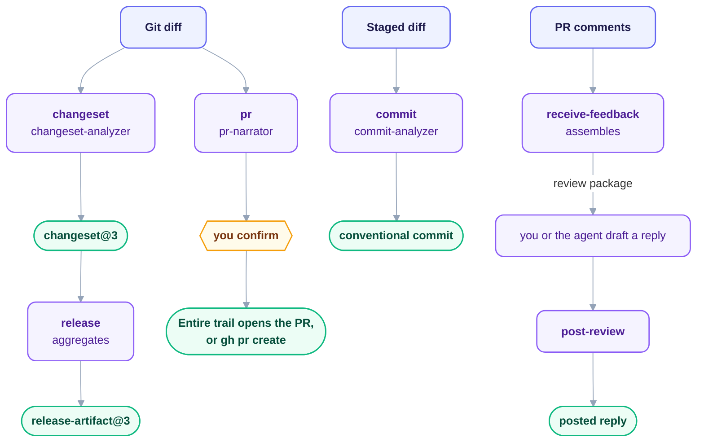

# courier — Ship Tooling

**Stage:** Ship · **Output:** `release-artifact@3` · **Version:** 5.0.0

Writes what goes out with a change: commit messages, pull request descriptions, changesets and release notes, plus review-feedback triage and posting a drafted review.

Six independent skills, not a pipeline. Each reads the diff and any linked spec or requirement, and follows the repository's own conventions where it has them. Courier does not critique code quality; that is the built-in `code-review` skill's job. `/wisp:ship` calls these skills in order (changeset, commit, PR, release) and runs only the ones you ask for.

---

## When to use

| Situation | Skill |
| :--- | :--- |
| You need a commit message that explains why, not only what | `courier/commit` |
| You are opening a PR and want a description a reviewer with no context can act on | `courier/pr` |
| A user-visible change needs a changeset or changelog entry | `courier/changeset` |
| You received review comments on your PR and want the full picture before replying | `courier/receive-feedback` |
| You have a drafted review or reply and want it posted to GitHub | `courier/post-review` |
| You are cutting a release and need release notes | `courier/release` |

Use the skill instead of writing these by hand: each carries rules that freehand text skips. Plain requests work: "commit this", "open a PR", "add a changeset", "address the feedback", "post this review", "cut a release".

## Skills

| Skill | What it does | Agent |
| :--- | :--- | :--- |
| `courier/commit` | A conventional commit message from the staged diff, explaining why | `commit-analyzer` |
| `courier/pr` | A PR title and body for a reviewer with no context, reporting observed verification and gaps; follows the repo's PR template | `pr-narrator` |
| `courier/changeset` | One layered `changeset@3` entry per user-visible outcome, an update to an existing entry, or a recommendation that none is needed | `changeset-analyzer` |
| `courier/receive-feedback` | Assembles a review package (diff summary, linked spec, test results, open questions) for feedback on your own PR | none |
| `courier/post-review` | Posts an already-drafted review or reply with `gh pr review` or `gh pr comment`, after you confirm | none |
| `courier/release` | Aggregates changesets since the last release into a `release-artifact@3`; the version is the highest `semver_impact` | none |

## Agents

| Agent | Tier | Does |
| :--- | :--- | :--- |
| `commit-analyzer` | haiku / low | Reads the staged diff and writes a conventional commit message that explains why |
| `pr-narrator` | sonnet / medium | Writes the PR title and body from the reviewer's side, assuming no prior context |
| `changeset-analyzer` | sonnet / medium | Classifies consumer and semver impact per outcome (`shared/references/delivery/changesets.md`) and writes `changeset@3` entries whose detail scales with that impact |

`receive-feedback`, `post-review` and `release` are mechanical, so the skill does the work itself.

## What it produces

- **`changeset@3`** (`shared/schemas/changeset@3.json`). When the repository keeps changesets as files (for example `.changeset/*.md`), each entry is also saved there in the repo's format and bump, through its own tool when it has one.
- **`release-artifact@3`** (`shared/schemas/release-artifact@3.json`). Not needed where the repo's release PR aggregates changesets.
- **Pull requests:** by default `courier/pr` pushes the branch and creates or links its Entire trail (`entire trail create`); Entire opens the PR from the trail, using the title and body. It runs `gh pr create` only when the repository's instructions say agents open PRs. Opening, pushing and posting always wait for your confirmation.

When the work produced `criteria_evidence`, `courier/changeset` takes it as input; otherwise it works from the diff.

## Hooks

None.

---

## Install

**Claude Code:** `/plugin marketplace add orin-dx/wisp-plugins`, then `/plugin install courier`.

**Codex:** `codex plugin marketplace add orin-dx/wisp-plugins`, then `codex plugin add courier@wisp-plugins`.

**Antigravity:** see the [root README](../../README.md#install).

## Example

After a fix, "add a changeset and open a PR" runs `courier/changeset`, which writes one entry for the user-visible outcome (or says none is needed for an internal change), then `courier/pr`, which shows you the title and body. On your confirmation it pushes the branch and hands them to the branch's Entire trail, which opens the PR.

References the agents load at runtime: `shared/references/delivery/commits.md`, `github.md`, `changesets.md`, and `shared/references/authoring/voice.md`.
