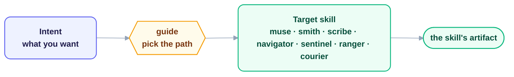

# guide — Start Here

**Stage:** Any · **Output:** routes to the right skill · **Version:** 1.0.0

Six commands named by what you want, not by which plugin does it. Each says which mode it chose and hands off to the skill that does the work, so that skill's checks run.

---

## When to Use

- You want options before deciding: `/guide:explore`
- You want to know whether something works: `/guide:spike`
- Something is broken, or a review left findings: `/guide:fix`
- You are building something real: `/guide:build`
- You want work verified or bugs found: `/guide:check`
- The work is ready to commit, document or release: `/guide:ship`

---

## Skills

| Skill | Does | Hands off to |
| :--- | :--- | :--- |
| `guide/explore` | Structurally different options, rendered, with a decision log | `muse:sketch`, then `muse:promote` |
| `guide/spike` | The smallest throwaway experiment that answers one question | `smith:spike` |
| `guide/fix` | A fix with a test that fails on the original bug, a review and an exit check | `smith:implement` (fix path) |
| `guide/build` | A path chosen by risk: gated spec and plan for shared work, a brief for contained work | `scribe`/`muse`, `navigator:plan`, `smith:implement` |
| `guide/check` | Verification against criteria, or a defect hunt | `sentinel:gate`, `ranger:audit` |
| `guide/ship` | Commit message, changeset, pull request, release notes | `courier` skills |

The pipeline plugins also refuse a direct call to one of their agents once per session until one of their skills has started, and say which skill to use. A second direct call goes through, so a deliberate direct use still works. This guard is a Claude Code hook; Codex and Antigravity rely on the skill text.

---

## Agents

None. `guide` has no subagents, so there are no tiers to set; every command is a routing step that names its mode and hands off to the skill that does the work.

## Pipeline



## Output schemas

None of its own. Each command returns the artifact of the skill it hands off to (`option-set@1`, `spike-report@1`, `spec@1`, `plan@1`, `verdict@3`, `finding-report@2`, `changeset@3`).

---

## Add to your project's AGENTS.md

```markdown
## Plugins
Start work through these commands so their checks run:
- options before deciding: /guide:explore — does it work: /guide:spike
- bug or review findings: /guide:fix — real feature or shared change: /guide:build
- verify or find bugs: /guide:check — commit, changeset, PR, release: /guide:ship
```

---

## Install

**Claude Code** — add the marketplace once, then install by ID:
```
/plugin marketplace add orin-dx/wisp-plugins
/plugin install guide
```

**AGY** — installs the full repo; see the [root README](../../README.md#install) for instructions, or run `agy-plugin add guide@wisp-plugins`.

**Codex** — see the [root Codex setup](../../README.md#codex), then run `codex plugin add guide@wisp-plugins`.

The commands hand off to skills in `muse`, `smith`, `scribe`, `navigator`, `sentinel`, `ranger` and `courier`; install the ones you use.
