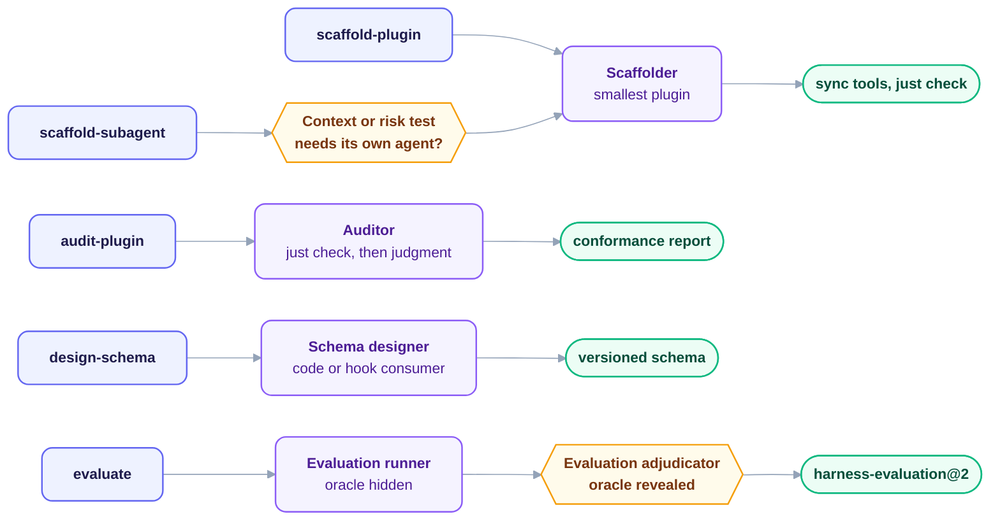

# mason — Plugin Authoring

**Stage:** Meta · **Output:** plugin artifacts and evaluations · **Version:** 5.0.0

Mason builds and audits plugins the v5 way: the fewest agents, one entry skill, rules that must hold enforced by hooks and checks, and language or house rules carried by packs. It also designs the schemas that code consumes and evaluates a workflow against fixed hidden-oracle fixtures.

- **Few agents:** an agent exists only where a fresh context must not share the worker's reasoning, one disputed claim needs settling, a bulk sweep should stay out of the worker's context, or an oracle must stay hidden. Never for a role or a pipeline stage (ADR 018).
- **One entry skill:** modes are one-line aliases into it. Independent skills only for genuinely independent intents.
- **No gate chain, no stage documents:** a brief in, evidence out. A schema only where code or a hook reads the artifact.
- **Outcome and evidence, not procedure:** four-part agent bodies (ADR 017): constitution, optional load_first, goal, judgment, output.
- **Must-hold rules are hooks:** `wisp:verifier` plus the handback validator and the Stop hook are the pattern. Codex has neither hook, so its skill states the rule.
- **Packs extend:** language and house rules go in `wisp-packs`, adopted with a `Packs:` line in `AGENTS.md`.

---

## When to Use

- You want to build a new plugin and need the right structure
- You've written a plugin and want to verify it conforms before release
- A code or hook consumer needs a new JSON schema
- You want one more agent for an existing plugin, and want to know whether it earns its place
- You want a repeatable release or regression evaluation with exact plugin provenance

**Invoke with:** `"Create a plugin called X that does Y"`, `"Audit the X plugin for conformance"`, `"Design a schema for an artifact that carries Z"`, `"Write a subagent for task T"`, or `"Evaluate this workflow against fixture F"`.

---

## Install

**Claude Code** — add the marketplace once, then install by ID:
```
/plugin marketplace add orin-dx/wisp-plugins
/plugin install mason
```

**AGY** — installs the full repo; see the [root README](../../README.md#install) for instructions.

**Codex** — see the [root Codex setup](../../README.md#codex), then run `codex plugin add mason@wisp-plugins`.

---

## Skills

| Skill | What it does | Subagent |
| :--- | :--- | :--- |
| `mason/scaffold-plugin` | Builds the smallest plugin that delivers a purpose, then runs the sync tools and `just check` | `scaffolder` |
| `mason/audit-plugin` | Checks an existing plugin against the v5 rules; returns pass, fail or warn per check, with evidence | `auditor` |
| `mason/design-schema` | Designs a draft 2020-12 schema for an artifact code or a hook consumes; checks for conflicts, or says none is warranted | `schema-designer` |
| `mason/scaffold-subagent` | Tests that one more agent needs its own context or risk tier, then creates only that agent file | `scaffolder` (single-agent mode) |
| `mason/evaluate` | Runs an isolated behavioral fixture and records a provenance-complete `harness-evaluation@2` | `evaluation-runner`, `evaluation-adjudicator` |

`audit-plugin` is not bare `audit`: that word is too generic for a plugin-level skill name (`shared/constitution.md`, Skill Names).

---

## Agents

| Agent | Mode | Tier | Description |
| :--- | :--- | :--- | :--- |
| `scaffolder` | Generation | sonnet / medium | Creates a plugin, or one agent, in the v5 shape and runs the sync tools and `just check`. Declines an agent that exists for a role or a stage. |
| `auditor` | Independent check | sonnet / medium | Audits a plugin for conformance: runs `just check`, then reads what no script decides. |
| `schema-designer` | Drafting | sonnet / medium | Designs a schema for a code or hook consumer; returns an empty schema when none is warranted. |
| `evaluation-runner` | Isolated execution | haiku / low | Runs public fixture input without seeing the oracle. |
| `evaluation-adjudicator` | Judgment | opus / high | Validates artifacts and seeded detections after the oracle is revealed. |

---

## Flow



The routes are independent. `scaffold-plugin` and `scaffold-subagent` share the scaffolder in different modes.

---

## Output Schemas

- `evaluation-run@1` — immutable runner evidence captured before the hidden oracle is revealed; see `shared/schemas/evaluation-run@1.json`
- `harness-evaluation@2` — adjudicated detections, false passes, corrections, provenance, and comparison data; see `shared/schemas/harness-evaluation@2.json`

Scaffold and audit routes produce or inspect repository files rather than an inter-agent JSON artifact. `design-schema` produces the requested new versioned schema.

---

## Conformance Checks (auditor)

`just check` decides manifests, versions, wiring, references and tests by exit code. The auditor reads the rest: agent justification, structure and constitution bytes, the entry skill, must-hold rules, packs, and the Codex counterpart. The rules live in `shared/constitution.md` and `agents/auditor.md`.

---

## Directory Layout

```
plugins/<id>/
├── plugin.json                  # id, name, version, description, author, skills, agents
├── README.md
├── CHANGELOG.md
├── shared -> ../../shared       # symlink, never copy
├── subagents -> agents          # symlink
├── skills/
│   └── <id>/
│       └── SKILL.md             # the entry skill; mode skills are one-line aliases into it
└── agents/
    └── <agent-name>.md          # only agents with a context or risk reason
```

After editing a version or a manifest, run `just claude-manifests-sync` and `just marketplace-sync`, then `just check`. Never hand-edit generated manifests or the README version line. A Codex-native tree lives under `harnesses/codex/plugins/<id>/`.

`mason/audit-plugin` checks every `SKILL.md` under `skills/`, not just one. `wisp` (one `work` skill with six aliases) is the reference for the entry-skill shape; `courier`, `muse` and `mason` split by independent intent.

---

## References

- `shared/agent-best-practices.md` — authoring guide for mason authors; agent bodies do not load it at runtime
- `shared/harness-authoring.md` — cross-harness identity, contract, workflow, and packaging boundaries
- `shared/references/evaluation/behavioral.md` — hidden-oracle evaluation and provenance rules
- `shared/schemas/` — existing schemas to check against when designing a new one
- `docs/adr/017-drop-agent-backstory.md`, `docs/adr/018-deep-core-by-context-and-risk.md` — the structure and split rules mason enforces
