# muse — Explore and Render

**Stage:** Exploration · **Output:** `option-set@1` · **Version:** 5.0.0

Shows you rendered options before anything is decided, then carries the one you choose into real work.

Muse is non-binding: no gate, no spec, no tests. It builds structurally different options, renders them and shows them before describing them, keeps a decision log, and stops before implementing. `/wisp:explore` starts `sketch`; specifying and checking a component's props, states and accessibility is `/wisp:build`'s job.

---

## When to use

| Situation | Skill |
| :--- | :--- |
| You want to see a few directions for a screen, component or approach before deciding | `muse/sketch` |
| A chosen option, or a spike that worked, should become real work | `muse/promote` |

Plain requests work: "show me some options for this screen", "try a few directions", "what could this look like", "promote option B", "that spike worked, make it a feature".

## Skills

| Skill | What it does | Agent |
| :--- | :--- | :--- |
| `muse/sketch` | Builds and renders three structurally different options per round (different arrangement, interaction model or hierarchy, not different colors), shows the renders first, and keeps a decision log in an `option-set@1` | `explorer` |
| `muse/promote` | Turns a chosen option or a working spike into a `requirement@1` carrying the decision, the approved render, and what was and was not verified; the only route from exploration into real work | none |

## Agents

| Agent | Tier | Does |
| :--- | :--- | :--- |
| `explorer` | sonnet / medium | Builds and renders one option for a sketch, writing only to a scratch directory, and returns an `option-set@1` holding only that option. Never ranks options. Started by `sketch`. |

```mermaid
%%{init: {'theme': 'base', 'flowchart': {'curve': 'basis', 'nodeSpacing': 40, 'rankSpacing': 56}, 'themeVariables': {'fontFamily': 'Inter, ui-sans-serif, system-ui, sans-serif', 'fontSize': '14px', 'lineColor': '#94a3b8', 'edgeLabelBackground': '#ffffff'}}}%%
flowchart LR
    classDef source fill:#eef2ff,stroke:#6366f1,stroke-width:1.5px,color:#1e1b4b,rx:10px,ry:10px,font-weight:600;
    classDef engine fill:#f5f3ff,stroke:#8b5cf6,stroke-width:1.5px,color:#4c1d95,rx:10px,ry:10px;
    classDef output fill:#ecfdf5,stroke:#10b981,stroke-width:1.5px,color:#064e3b,rx:10px,ry:10px,font-weight:600;

    Intent["<b>Design intent</b><br/>free text or <code>requirement@1</code>"] --> Sketch["<b>sketch</b><br/>explorer builds and renders"]
    Sketch --> Options(["option-set@1"])
    Options -.->|"another round"| Sketch
    Options -->|"you choose"| Promote["<b>promote</b>"]
    Spike(["spike-report@1"]) --> Promote
    Promote --> Req(["requirement@1"])
    Req --> Build["<b>wisp</b><br/>/wisp:build"]

    class Intent source
    class Sketch,Promote,Build engine
    class Options,Req,Spike output
```

You decide; nothing here ranks or advises. For design work the first round starts with four one-line directions for you to pick from. After five rounds without a decision, `sketch` offers to narrow the brief, park the exploration or abandon it.

## What it produces

- **Renders and a board:** each option as a static page under `.scratch/<id>/<option-id>/`, rendered at the brief's viewports and themes (default 390x844 and 1440x900), with `.scratch/<id>/board.html` showing them side by side. If nothing can render, it says so and gives the command that opens the files.
- **`option-set@1`** (`shared/schemas/option-set@1.json`), written to `docs/sketches/<id>.json`: the anchor brief, a status (`exploring`, `decided`, `abandoned`), one to five options each with its own status and reason, assumptions, open questions, renders, and an append-only decision log.
- **`requirement@1`** (`shared/schemas/requirement@1.json`) from `promote`, written where the repository keeps requirements (a file or its issue tracker), linking the sketch or spike.

`sketch` writes only under `.scratch/<id>/` and to `docs/sketches/<id>.json`, and never edits existing source, configuration or specs. Add `.scratch/` to your ignore file.

## Hooks

None.

---

## Install

**Claude Code:** `/plugin marketplace add orin-dx/wisp-plugins`, then `/plugin install muse`.

**Codex:** `codex plugin marketplace add orin-dx/wisp-plugins`, then `codex plugin add muse@wisp-plugins`.

**Antigravity:** see the [root README](../../README.md#install).

## Example

`/muse:sketch three layouts for the billing settings page, using our tokens` writes a brief and offers four one-line directions. You pick one; it builds three options inside it (say a single long form, tabs by topic, and a summary with edit drawers), renders each at phone and desktop width, and shows the board before describing anything. You answer "B, but with the summary from C"; the decision goes in the log and the next round stays inside that direction. When you are happy, `/muse:promote` turns the chosen option into a `requirement@1` for `/wisp:build`.
