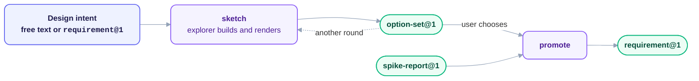

# muse — Explore and Render

**Stage:** Exploration · **Output:** `option-set@1` · **Version:** 1.2.0

Shows options before anything is decided. Muse builds structurally different options, renders them and shows them before describing them, keeps a decision log, and carries the chosen option into a `requirement@1` when the user is ready. It is non-binding: no gate, no spec, no tests.

- **Sketches** structurally different options, rendered and shown before they are described, with a decision log
- **Promotes** a chosen option (or a spike that worked) into a `requirement@1`, the only route from a sketch into gated work

`sketch` and `promote` are the exploration path and never gate anything (see `shared/references/architecture/modes.md`). Specifying a component's props, states and accessibility is the work skill's job in the `wisp` plugin; the UI-state and accessibility rules it uses live in `shared/references/`.

---

## When to Use

- You want to see a few directions for a screen or component before deciding what to build (`sketch`)
- A chosen option is ready to become real work (`promote`)

**Invoke with:** `"Show me some options for this screen"`, `"Try a few directions"`, `"What could this look like"`, `"Promote option B"`

---

## Install

**Claude Code** — add the marketplace once, then install by ID:
```
/plugin marketplace add orin-dx/wisp-plugins
/plugin install muse
```

**AGY** — installs the full repo; see the [root README](../../README.md#install) for instructions.

**Codex** — see the [root Codex setup](../../README.md#codex), then run `codex plugin add muse@wisp-plugins`.

---

## Skills

| Skill | What it does | Subagent |
| :--- | :--- | :--- |
| `muse/sketch` | Builds and renders three structurally different options per round, shows them before describing them, and keeps a decision log in an `option-set@1`. Non-binding: no gate, no spec, no tests | `explorer` |
| `muse/promote` | Turns a chosen option (or a spike that worked) into a `requirement@1` that carries the decision, the approved render, and what was and was not verified | none |

---

## Subagents

| Subagent | Role | Tier | Description |
| :--- | :--- | :--- | :--- |
| `explorer` | Divergent Option Explorer | sonnet / medium | Builds and renders one structurally different option for a sketch and returns an `option-set@1` holding only that option. Writes only to a scratch directory, never ranks options. Internal to `sketch`. |

---

## Flow



The user decides; nothing here advises or ranks. After about five rounds without a decision the skill offers to narrow the brief, park the exploration or abandon it.

---

## Output Schemas

**`option-set@1`** — produced by `sketch`; see `shared/schemas/option-set@1.json`. A non-binding sketch (`fidelity: sketch`): an anchor `brief`, a `status` (`exploring`, `decided`, `abandoned`), a `round`, and one to five structurally different `options`, each with its own `status` (`open`, `parked`, `chosen`, `rejected`), a `reason` for every status except `open`, assumptions, open questions and `renders`; plus an append-only `decisions` log. Open questions are allowed here and not in a spec. Nothing in it enters planning until `promote` turns the chosen option into a requirement.

**`requirement@1`** — produced by `promote` from a decided sketch; see `shared/schemas/requirement@1.json`.

---

## Next Stage

Hand the `requirement@1` to the **wisp** plugin to build it through its work skill.
