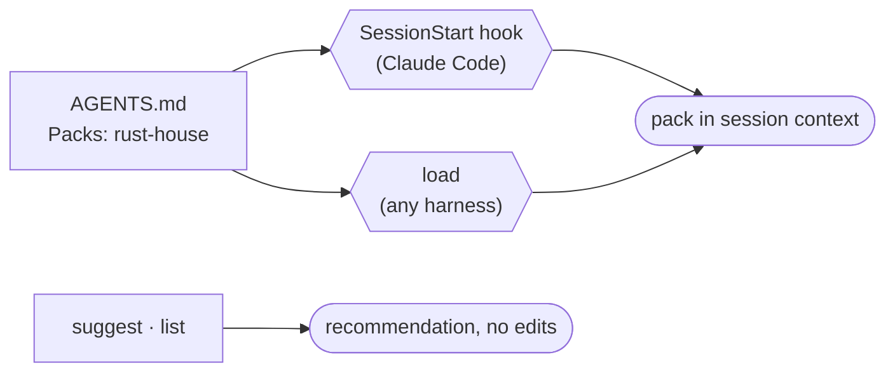

# wisp-packs — House Packs

**Stage:** Any · **Output:** none (packs shape how work is done) · **Version:** 1.0.0

A pack is a short markdown file on how this owner builds in one area: when it applies, what we do differently from what a model would default to, the checks that prove it, and a file to imitate. Packs are mined from real repos and review findings, not written from scratch. A repo opts in with one line.

---

## When to Use

- A Rust or TypeScript repo should be built the way the owner's other repos are: `Packs: rust-house` in its `AGENTS.md`
- You want a pack for this session only: `/wisp-packs:load rust-house`
- You want to know which packs exist or which this repo declares: `/wisp-packs:list`
- You are not sure which packs fit a repo: `/wisp-packs:suggest`

---

## Skills

| Skill | Does | Edits files |
| :--- | :--- | :--- |
| `wisp-packs/load` | Reads the named packs and applies them for the rest of the session | No |
| `wisp-packs/list` | Lists available packs and the `Packs:` lines the repo declares | No |
| `wisp-packs/suggest` | Looks at the repo and recommends packs and where to point to them | No |

## Packs

| Pack | Applies when |
| :--- | :--- |
| `rust-house` | The repo is a Rust workspace |
| `ts-house` | The repo has TypeScript packages or apps built with pnpm |

---

## Adopt a pack

Add one line to the `AGENTS.md` where the pack applies:

```markdown
Packs: rust-house
```

- Several packs: `Packs: rust-house, ts-house`. Names are separated by commas or spaces.
- A monorepo: put the line in the nested `AGENTS.md` of the package it applies to. The hook reads `AGENTS.md` at the working directory, in the directories above it up to the repository root, and in directories up to four levels below it.
- A pack named in several files is injected once. An unknown name is ignored. A `Packs:` line inside a fenced code block is ignored.

| Harness | What happens |
| :--- | :--- |
| Claude Code | A SessionStart hook reads the `Packs:` lines and injects those packs into the session's context. It fails open: on any error nothing is injected and the session starts normally. |
| Codex | No injection (no equivalent SessionStart hook). `AGENTS.md` is always in context, so the line is visible; the agent loads the pack with `load` (or reads the pack file) when it starts work. Packs also travel as plain files: copy one into the repo and link it. |
| Antigravity | Not verified. Use the `Packs:` line and `load`, as on Codex. |

To try a pack once, run `/wisp-packs:load rust-house`.

---

## What a pack may and may not do

Packs are prompt content, so installing one is a trust decision.

- A pack states hazards, evidence and deviations from a model's defaults. It does not teach the language.
- A pack never adds a command the repo does not declare. It names a check only as "the repo's lint" or by a command the repo already has, and says when the repo lacks one.
- The repo's own `AGENTS.md` and the user's instructions win over a pack.
- A pack may tighten a check unasked. Loosening a check needs the owner.
- Prefer a check (a lint, a type, an architecture test) over prose. A rule with no enforcing check says so.

## Pack format

Plain markdown, no schema. The first line says when it applies. Then, per rule: the outcome, the evidence that shows it holds, the check that enforces it when there is one. End with an exemplar to imitate. A rule goes in a shared pack only when it holds in at least two repos.

---

## Agents

None. `wisp-packs` has no subagents, so there are no tiers to set; its skills read files and report.

## Pipeline



## Output schemas

None. Packs are prompt content and the commands return short text.

---

## Install

**Claude Code** — add the marketplace once, then install by ID:
```
/plugin marketplace add orin-dx/wisp-plugins
/plugin install wisp-packs
```

**AGY** — installs the full repo; see the [root README](../../README.md#install) for instructions, or run `agy-plugin add wisp-packs@wisp-plugins`.

**Codex** — see the [root Codex setup](../../README.md#codex), then run `codex plugin add wisp-packs@wisp-plugins`.
