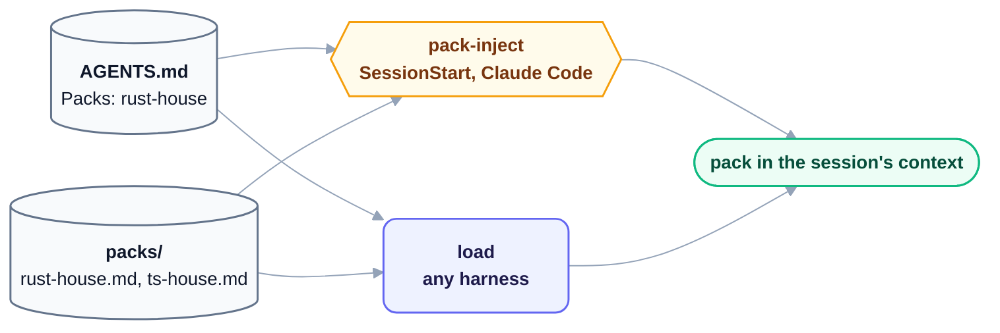

# wisp-packs — House Packs

**Stage:** Any · **Output:** none (packs shape how work is done) · **Version:** 1.0.0

Makes the agent build the way the owner's other repos are built: a pack is a short markdown file of house rules for one area, applied when a repo opts in with one line.

Each pack says when it applies, where the house rules differ from what a model would do by default, the checks that prove them, and a file to imitate. Packs are mined from real repos and review findings, not written from scratch.

---

## When to use

| Situation | Do |
| :--- | :--- |
| A Rust or TypeScript repo should follow the owner's house rules in every session | Add `Packs: rust-house` (or `ts-house`) to its `AGENTS.md` |
| You want a pack for this session only | `/wisp-packs:load rust-house` |
| You want to see which packs exist and which this repo declares | `/wisp-packs:list` |
| You are not sure which packs fit a repo | `/wisp-packs:suggest` |

## Skills

| Skill | Does | Edits files |
| :--- | :--- | :--- |
| `wisp-packs/load` | Reads the named packs and applies them for the rest of the session | No |
| `wisp-packs/list` | Lists available packs, the `Packs:` lines the repo declares, and the gaps between them | No |
| `wisp-packs/suggest` | Looks at the repo's manifests, configs and CI, and recommends packs and the `AGENTS.md` to put each line in | No |

## Packs

| Pack | Applies when |
| :--- | :--- |
| `rust-house` | The repo is a Rust workspace (a `Cargo.toml` with `[workspace]`) |
| `ts-house` | The repo has TypeScript packages or apps built with pnpm |

## Agents

None. The skills read files and report.

---

## Adopt a pack

Add one line to the `AGENTS.md` where the pack applies:

```markdown
Packs: rust-house
```

- Several packs: `Packs: rust-house, ts-house` (commas or spaces).
- A monorepo: put the line in the nested `AGENTS.md` of the package it applies to. The hook reads `AGENTS.md` at the working directory, in the directories above it up to the repository root, and up to four levels below it.
- A pack named in several files is injected once. An unknown name is ignored. A `Packs:` line inside a fenced code block is ignored, so examples in docs load nothing.



| Harness | What happens |
| :--- | :--- |
| Claude Code | A SessionStart hook (`shared/hooks/pack-inject.py`) reads the `Packs:` lines and injects those packs into the session's context. It fails open: on any error nothing is injected and the session starts normally. To stop it, remove the line or disable the plugin. |
| Codex | No injection. `AGENTS.md` is always in context, so the agent sees the line and loads the packs with `load` when it starts work. |
| Antigravity | Not verified. Use the `Packs:` line and `load`, as on Codex. |

---

## What a pack may and may not do

Packs are prompt content, so installing one is a trust decision.

- A pack states hazards, evidence and deviations from a model's defaults. It does not teach the language.
- A pack never adds a command the repo does not declare. It names a check only as "the repo's lint" or by a command the repo already has, and says when the repo lacks one.
- The repo's own `AGENTS.md` and the user's instructions win over a pack.
- A pack may tighten a check unasked. Loosening a check needs the owner.

## Write a pack

Add `plugins/wisp-packs/packs/<name>.md` (lowercase letters, digits and hyphens). Plain markdown, no schema:

1. The first line says when the pack applies; `list` and `suggest` show it.
2. Per rule: the outcome, the evidence that shows it holds, and what enforces it: `[lint]`, `[type]` or `[review]`. Prefer a check over prose; a rule with no enforcing check says so.
3. End with an exemplar file to imitate.

A rule goes in a shared pack only when it holds in at least two repos. Run `just marketplace-sync` afterwards: the Codex bundle copies `packs/` from here.

---

## Install

**Claude Code:** `/plugin marketplace add orin-dx/wisp-plugins`, then `/plugin install wisp-packs`.

**Codex:** `codex plugin marketplace add orin-dx/wisp-plugins`, then `codex plugin add wisp-packs@wisp-plugins`.

**Antigravity:** see the [root README](../../README.md#install).

## Example

A Rust workspace adds `Packs: rust-house` to its root `AGENTS.md`. The next Claude Code session starts with the pack in context, so a `/wisp:fix` there uses `?` instead of `unwrap()` outside tests, adds a typed error variant instead of a `String` one, and runs only the lint commands the repo's justfile or CI declares.
