# wisp — Core

**Stage:** Any · **Output:** the change, its evidence and a `Not verified:` list · **Version:** 1.0.0

One way to start work. `wisp` sizes each change by how hard it is to undo and how far it reaches, states what done means and how it will be proven before anything is edited, and spends independent review only where a confident mistake would be costly.

- **Sizes the change:** contained, shared or irreversible. The tier alone sets the review depth.
- **States the brief first:** outcome, constraints, evidence bar.
- **Picks the mode:** explore, spike, fix, build, check or ship.
- **Verifies with fresh eyes:** shared and irreversible work goes to a verifier that sees the brief, the change and the evidence, never the worker's reasoning, and runs things itself.
- **Asks you only what matters:** decisions that change scope or cannot be undone, as short decision cards with a recommendation and a default.

What you see: a brief and decision cards on the way in; the diff or render, the evidence, a `Not verified:` list and the pull request or changelog on the way out. No mandatory spec, plan or sign-off stage.

---

## When to Use

- Any change, when you are not sure which path fits: `/wisp:work`
- You want options before deciding: `/wisp:explore`
- You want to know whether something works: `/wisp:spike`
- Something is broken, or a review left findings: `/wisp:fix`
- You are building something real: `/wisp:build`
- You want work verified or bugs found: `/wisp:check`
- The work is ready to commit, document or release: `/wisp:ship`

**Invoke with:** `"Fix this bug"`, `"Build this feature"`, `"Is this done?"`, `"Find bugs in this"`, `"Does this library work here?"`, `"Show me some options"`, `"Ship this"`

---

## Install

**Claude Code** — add the marketplace once, then install by ID:
```
/plugin marketplace add orin-dx/wisp-plugins
/plugin install wisp
```

**AGY** — installs the full repo; see the [root README](../../README.md#install) for instructions, or run `agy-plugin add wisp@wisp-plugins`.

**Codex** — see the [root Codex setup](../../README.md#codex), then run `codex plugin add wisp@wisp-plugins`. Codex has no Stop hook and no named subagents; its skills carry the `Not verified:` rule themselves and run the verifier as a fresh subagent from a role card, or as a separate pass when subagents are unavailable.

Exploration hands off to `muse` and shipping to `courier`; install them for those modes.

---

## Tiers

| Tier | What it means | Review |
| :--- | :--- | :--- |
| contained | Reverts cleanly, nothing depends on it, a project check exercises it | The project's checks and a failing-then-passing test; no verifier |
| shared | Other code, users or sessions depend on it, or a spec or plan makes claims about code | The verifier: one round, one targeted retry, then the persistent blockers come to you |
| irreversible | Hard to undo or crosses the repository boundary (migration, publish, release, shared-branch push) | The verifier, then a decision card before the action |

Details: [`shared/references/work/modes.md`](../../shared/references/work/modes.md).

---

## Skills

| Skill | What it does | Hands off to |
| :--- | :--- | :--- |
| `wisp/work` | Sizes the change, states the brief, picks the mode and review depth, and asks only for scope-changing or irreversible decisions | `verifier`, `adversary`, `recon`; `muse`, `courier` |
| `wisp/explore` | Structurally different options, rendered, with a decision log; non-binding | `muse:sketch`, then `muse:promote` |
| `wisp/spike` | The smallest throwaway experiment that answers one question; returns `spike-report@1` | `muse:promote` when it works |
| `wisp/fix` | A test that fails on the original defect, the fix, and a search for the same mistake elsewhere | `verifier` at shared tier and above |
| `wisp/build` | Work from a brief; a spec or plan only where one pays | `verifier` at shared tier and above; `muse:sketch` to see UI options first |
| `wisp/check` | Confirm work against its brief or criteria, or hunt for defects | `verifier`, `adversary` |
| `wisp/ship` | Only the shipping steps asked for, confirmed before anything leaves the machine | `courier:changeset`, `courier:commit`, `courier:pr`, `courier:release` |

The six mode skills are one-line aliases that start `work` in that mode.

---

## Agents

| Agent | Mode | Tier | Description |
| :--- | :--- | :--- | :--- |
| `verifier` | Independent judgment | opus / high | Fresh-context check of shared or irreversible work, or of a spec or plan that makes claims about code. Runs code, a build or a render to test each claim and returns a binding `verdict@3`. Two rounds; a second failing round escalates to you. |
| `adversary` | Refutation | opus / high | Settles one finding or claim against current code: confirms only with a concrete failing scenario, dismisses only with the guard that blocks it. Returns `candidate-assessment@1`. |
| `recon` | Enumeration | haiku / low | Read-only inventory of an unfamiliar workspace: languages, entry points, the project's own check commands, workspace state. Returns `workspace-manifest@1`. |

The worker is the primary agent, in one context. There is no implementer, reviewer or planner agent: the work and its tests happen where the full context is, and only the check that needs separate eyes is separate.

---

## Pipeline

```mermaid
%%{init: {'theme': 'base', 'flowchart': {'curve': 'basis', 'nodeSpacing': 40, 'rankSpacing': 56}, 'themeVariables': {'fontFamily': 'Inter, ui-sans-serif, system-ui, sans-serif', 'fontSize': '14px', 'lineColor': '#94a3b8', 'edgeLabelBackground': '#ffffff'}}}%%
flowchart LR
    classDef source fill:#eef2ff,stroke:#6366f1,stroke-width:1.5px,color:#1e1b4b,rx:10px,ry:10px,font-weight:600;
    classDef engine fill:#f5f3ff,stroke:#8b5cf6,stroke-width:1.5px,color:#4c1d95,rx:10px,ry:10px;
    classDef router fill:#fffbeb,stroke:#f59e0b,stroke-width:1.5px,color:#78350f,rx:10px,ry:10px,font-weight:600;
    classDef output fill:#ecfdf5,stroke:#10b981,stroke-width:1.5px,color:#064e3b,rx:10px,ry:10px,font-weight:600;

    Brief["<b>Request</b><br/>brief and decision cards"] --> Work{{"<b>work</b><br/>tier, mode, evidence bar"}}
    Work --> Do["<b>Worker</b><br/>one full context"]
    Do -->|"contained"| Out(["diff, evidence,<br/>Not verified list"])
    Do -->|"shared or irreversible"| Verify{{"<b>verifier</b><br/>fresh context, verdict@3"}}
    Verify -->|"pass"| Out
    Verify -.->|"blockers, one retry"| Do
    Verify -.->|"escalation"| Owner(["owner decides"])
    Out --> Ship["<b>ship</b><br/>courier"]

    class Brief source
    class Do engine
    class Work,Verify router
    class Out,Owner,Ship output
```



## Output schemas

- `verdict@3` (`shared/schemas/verdict@3.json`) from the verifier, checked by the handback hook
- `candidate-assessment@1` (`shared/schemas/candidate-assessment@1.json`) from the adversary
- `workspace-manifest@1` (`shared/schemas/workspace-manifest@1.json`) from recon
- `spike-report@1` (`shared/schemas/spike-report@1.json`) from spike mode

---

## Hooks (Claude Code)

| Hook | Event | Does |
| :--- | :--- | :--- |
| `shared/hooks/stop-check.py` | Stop | With uncommitted changes and no `Not verified:` line in the final message, asks once for one. Off with `WISP_STOP_CHECK=off`. |
| `shared/hooks/validate-handback.py` | PreToolUse `SubagentHandback` | Rejects a verifier handback that is not a valid `verdict@3`, or that passes or fails to escalate past the second round. |

Both fail open: a broken hook never stalls a session.

---

## Add to your project's AGENTS.md

```markdown
## Work
Start changes with /wisp:work (or /wisp:fix, /wisp:build, /wisp:check, /wisp:spike, /wisp:explore, /wisp:ship).
State the tier, the brief and the evidence bar first; end with the evidence and a "Not verified:" list.
```
