# wisp — Core

**Stage:** Any · **Output:** the change, its evidence and a `Not verified:` list · **Version:** 1.0.0

The one way to start work: `wisp` sizes each change by how hard it is to undo, states what done means and how it will be proven before anything is edited, and spends independent review only where a confident mistake would be costly.

---

## When to use

| Situation | Command |
| :--- | :--- |
| Any change, or you are not sure which path fits | `/wisp:work` |
| You want to see options before deciding | `/wisp:explore` |
| You want to know whether a tool or approach works here | `/wisp:spike` |
| Something is broken, or a review left findings | `/wisp:fix` |
| You are building a feature or a change other work will depend on | `/wisp:build` |
| You want work verified, or bugs found | `/wisp:check` |
| The work is ready to commit, document or release | `/wisp:ship` |

Plain requests work too: "fix this bug", "is this done?", "find bugs in this", "does this library work here?", "ship this".

---

## Skills

| Skill | What it does | Hands off to |
| :--- | :--- | :--- |
| `wisp/work` | States the brief (outcome, constraints, evidence bar), sizes the tier, picks the mode and review depth; asks you only for decisions that change scope or cannot be undone | `verifier`, `adversary`, `recon`; `muse`, `courier` |
| `wisp/explore` | Structurally different options, rendered, with a decision log; nothing is built for real | `muse:sketch`, then `muse:promote` |
| `wisp/spike` | The smallest throwaway experiment that answers one question, written only under `.scratch/<id>/` | `muse:promote` when it works |
| `wisp/fix` | A test that fails on the original defect, the fix, and a search for the same mistake elsewhere | `verifier` at shared tier and above |
| `wisp/build` | Work from the brief; a spec or plan only where one pays | `verifier` at shared tier and above; `muse:sketch` when the look is undecided |
| `wisp/check` | Confirms work against its brief or criteria, or hunts defects with the hazard references | `verifier`, `adversary` |
| `wisp/ship` | Only the shipping steps asked for, confirmed before anything is pushed, posted or published | `courier:changeset`, `courier:commit`, `courier:pr`, `courier:release` |

The six mode skills are one-line aliases that start `work` in that mode.

## Tiers

| Tier | What it means | Review |
| :--- | :--- | :--- |
| contained | Reverts cleanly, nothing depends on it, a project check exercises it | The project's checks and a failing-then-passing test; no verifier |
| shared | Other code, users or sessions depend on it, or a spec or plan makes claims about code | The verifier: one round, one targeted retry, then the persistent blockers come to you |
| irreversible | Hard to undo or crosses the repository boundary (migration, publish, release, shared-branch push) | The verifier, then a decision card before the action |

When two tiers fit, the higher applies. Details: [`shared/references/work/modes.md`](../../shared/references/work/modes.md).

---

## Agents

| Agent | Tier | Does |
| :--- | :--- | :--- |
| `verifier` | opus / high | Checks shared or irreversible work, or a spec or plan that makes claims about code, in a fresh context. Gets the brief, the change and the evidence, never the worker's reasoning; runs code, a build or a render itself. Returns `verdict@3`; a second failing round escalates to you. |
| `adversary` | opus / high | Settles one finding or claim against current code: confirms only with a concrete failing scenario, dismisses only with the guard that blocks it. Returns `candidate-assessment@1`. |
| `recon` | haiku / low | Read-only inventory of an unfamiliar workspace: languages, entry points, the project's own check commands. Returns `workspace-manifest@1`. Skipped when `AGENTS.md` or the justfile already names them. |

The worker is the primary agent, in one context. There is no implementer, reviewer or planner agent.

```mermaid
%%{init: {'theme': 'base', 'flowchart': {'curve': 'basis', 'nodeSpacing': 40, 'rankSpacing': 56}, 'themeVariables': {'fontFamily': 'Inter, ui-sans-serif, system-ui, sans-serif', 'fontSize': '14px', 'lineColor': '#94a3b8', 'edgeLabelBackground': '#ffffff'}}}%%
flowchart LR
    classDef source fill:#eef2ff,stroke:#6366f1,stroke-width:1.5px,color:#1e1b4b,rx:10px,ry:10px,font-weight:600;
    classDef engine fill:#f5f3ff,stroke:#8b5cf6,stroke-width:1.5px,color:#4c1d95,rx:10px,ry:10px;
    classDef router fill:#fffbeb,stroke:#f59e0b,stroke-width:1.5px,color:#78350f,rx:10px,ry:10px,font-weight:600;
    classDef output fill:#ecfdf5,stroke:#10b981,stroke-width:1.5px,color:#064e3b,rx:10px,ry:10px,font-weight:600;
    classDef alert fill:#fff1f2,stroke:#f43f5e,stroke-width:1.5px,color:#881337,rx:10px,ry:10px,font-weight:600;

    Brief["<b>Request</b><br/>brief and decision cards"] --> Work{{"<b>work</b><br/>tier, mode, evidence bar"}}
    Work --> Do["<b>Worker</b><br/>one full context"]
    Do -->|"contained"| Out(["diff, evidence,<br/>Not verified list"])
    Do -->|"shared or irreversible"| Verify{{"<b>verifier</b><br/>fresh context, verdict@3"}}
    Verify -->|"pass"| Out
    Verify -.->|"blockers, one retry"| Do
    Verify -.->|"fails again"| Owner(["you decide"])
    Out --> Ship["<b>ship</b><br/>courier"]

    class Brief source
    class Do,Ship engine
    class Work,Verify router
    class Out output
    class Owner alert
```



## What it produces

What you read: the diff or render, the evidence (each command and its observed result), a `Not verified:` list, and the next step. Typed outputs: `verdict@3` (verifier), `candidate-assessment@1` (adversary), `workspace-manifest@1` (recon), `spike-report@1` (spike mode), all in `shared/schemas/`.

## Hooks (Claude Code)

| Hook | Event | Does |
| :--- | :--- | :--- |
| `shared/hooks/stop-check.py` | Stop | With uncommitted changes and no `Not verified:` line in the final message, asks once for one. Off with `WISP_STOP_CHECK=off`. |
| `shared/hooks/validate-handback.py` | PreToolUse `SubagentHandback` | Rejects a verifier report that is not a valid `verdict@3`, or a report past the second round that is not a fail with `escalation_required`. Auto mode, local subagents only. `WISP_HANDBACK_TRACE=<file>` logs each event. |

Both fail open: a broken hook never stalls a session. Codex has neither; its skills state both rules.

---

## Install

**Claude Code:** `/plugin marketplace add orin-dx/wisp-plugins`, then `/plugin install wisp`.

**Codex:** `codex plugin marketplace add orin-dx/wisp-plugins`, then `codex plugin add wisp@wisp-plugins`. The verifier runs as a fresh subagent from the `judge` role card, or as a separate pass recorded as not independent when subagents are unavailable.

**Antigravity:** see the [root README](../../README.md#install); hooks there are not verified.

Exploration hands off to `muse` and shipping to `courier`; install them for those modes. To make every session in a repo start this way, add to its `AGENTS.md`:

```markdown
## Work
Start changes with /wisp:work (or /wisp:fix, /wisp:build, /wisp:check, /wisp:spike, /wisp:explore, /wisp:ship).
State the tier, the brief and the evidence bar first; end with the evidence and a "Not verified:" list.
```

## Example

`/wisp:fix the CSV export drops rows whose date is empty` opens with `Mode: fix. Tier: shared.` and a brief whose evidence bar is the repo's test command plus a new test that fails on the old code. It writes that test, fixes the bug, searches the other exporters for the same mistake, sends the change to the verifier, and ends with the evidence, the verdict and `Not verified:` (for example, "the XLSX exporter was not exercised").
